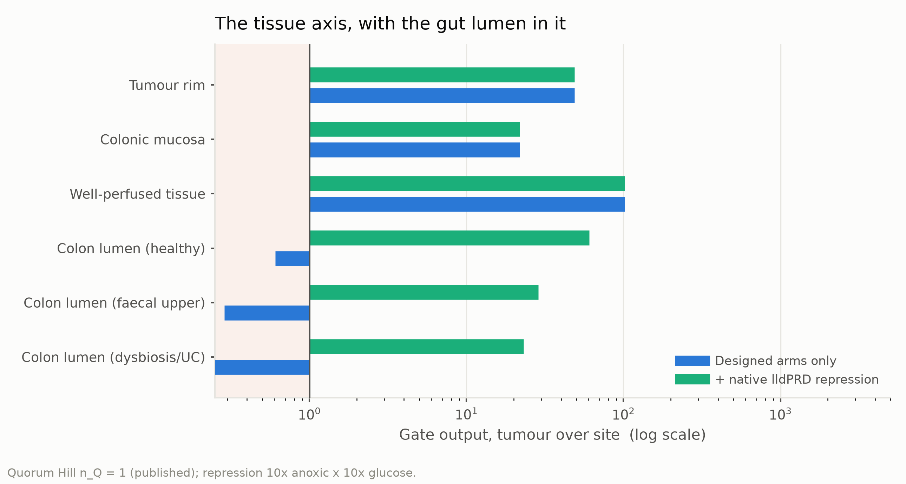
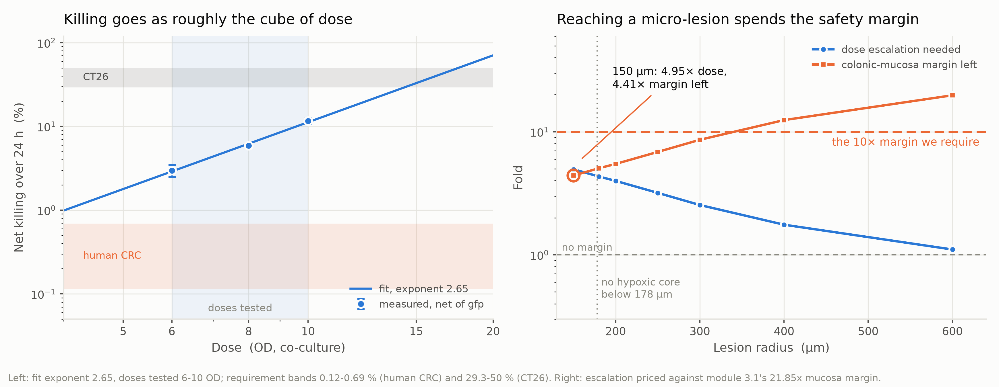

# Description 建模段 — 插进湿实验组 `Project 4.0.docx` 的 01 Description

> **给 wiki / 文档合并同学的说明（不要发布这一段）**
>
> - 这一节是**插件，不是整页**：湿实验组 `Project 4.0.docx` 的 01 Description 已经写了
>   1.1 挑战、1.2 EcN 选型、1.3 FLAME 方案与线路、1.4 目标与前景。下面这节
>   **按 1.5 插在 1.4 之后、References 之前**，背景、线路、底盘理由一律不重复。
>   要贴的是构建产物 `outputs/description_modeling_section.md`（引文编号已解好）。
> - **引文编号从 [6] 开始**，接着他们 Description 页的 [1]–[5]；文末只给新增的两条，
>   合并时直接追加到他们那张表后面。如果他们那页的条数变了，改
>   `build_description_docx.py` 里的 `FIRST_REFERENCE` 重新构建，不要手改编号。
> - 图 2 张（`model_v2/outputs/figures/`）。**线路图不给**——他们 1.3 已经有整体示意图，
>   再放一张是重复。
> - **图注已按诺诺比 2026-10-20 的要求重写**：`Figure n. 标题.` 粗体不斜体，后面说明
>   不粗不斜；只陈述图里有的事实（轴、标度、系列、色带、标注值），不写推断；正文
>   第一次提到每张图都带 `(Fig. n)`。两条失败会直接让构建退出：图注没人在正文里点名、
>   正文点了没有图注。
> - **图号从 Fig. 2 起**，因为他们 1.3 那张整体示意图是 Fig. 1。若他们那页在我们这节
>   之前的图不止一张，改 `build_description_docx.py` 的 `FIRST_FIGURE` 重新构建，
>   同样不要手改编号。**这件事要在合稿时确认一次。**
> - **图片内部的推断句已全部拿掉**（2026-10-21）：改的是 `src/plots.py`，共 5 张——
>   fig3_1 删"Bottleneck moves from the dysbiotic lumen to the mucosa."、fig3_3 删
>   "Structural: true for every EC50, Hill and basal."、fig4_6 删"CT26 needs 1.3-1.8x…"
>   与标注里的"— under the line"、fig3_5 的"$S_T$ three times $S_1$…"改成只给比值、
>   fig4_4 删"not micrometastases"；底注一律只写该图画在什么参数/什么带上。
>   fig4_4 图内"ON band (9.23)"引的是已废弃的 9.23 文档编号，一并改成"ON band (1000 µm)"。
>   五张都要重新上传到 wiki 换掉旧图，新图与对应图注见 `Model_Figure_Legends.docx`，
>   上传用的 webp 在 `outputs/figures/wiki_upload/`。
> - **图是矢量的**：`src/plots.py` 每张图同时写 PNG、SVG、PDF，Word 里嵌的是
>   “PNG + SVG”两层（`src/docx_vector.py` 在构建末尾挂上 SVG），Word 2016 以上与
>   新版 WPS 按矢量渲染，旧版本退回 300 dpi 的 PNG。给 wiki 的 SVG 在
>   `outputs/figures/wiki_upload/`。
> - **这节的两条图注是三处共用的**：`fig3_1` 与 Model 页 Figure 4 同图，`fig4_6` 与
>   Model 页 Figure 8、Engineering Figure 4 同图。三处必须一字不差（只有 Model 页那两条
>   多方程编号），`build_figure_legends_docx.py` 在构建时会比对 Engineering 与本稿的
>   剂量图图注，不一致就直接退出。要改图注，三处一起改。
> - 标题下那行中文小注是仿他们每节的写法，发布前和他们的一起删。
> - **一处要和他们对齐**：他们 Design 2.2.1 的缺氧启动子引的是 BBa_K1123000，
>   乳酸启动子引 BBa_K822000；我们模型用的是 pPepT 与 BBa_M36021（BBa_K822000 的
>   332 bp 衍生件）。这一节**刻意不点启动子名**，只说"缺氧臂/乳酸臂"，避免两份稿子
>   当面打架；但零件表最终必须统一，这件事要在合稿会上定。
> - 正文每个数字都来自 `model_v2/` 的代码，可追到函数和测试；详细推导在 Model 页。
> - 约 620 词。

=== PAGE TEXT ===

## 1.5 Modelling: What the Numbers Changed in the Design

建模段：AND 门在哪些位点仍会打开、哪些设计"改进"会破坏安全性，以及有效剂量反推。

The architecture described above is designed for preferential activation rather
than tumour-exclusive expression. That design choice raises a question the
architecture alone cannot answer: at which anatomical sites, and under which
conditions, does preferential become sufficient? We therefore built a
quantitative model of the circuit and of the environments it would meet,
calibrated on the 391 measurements this cycle's wet lab produced. Four of its
results changed the design rather than illustrating it.

Signal integration behaves multiplicatively at the endpoint, but not before it.
The interaction between the hypoxia-associated and lactate-associated arms is
zero within error at 24 h, and the factorised description predicts a held-out
input combination to within 2.2 %. At 6 and 9 h the same prediction is wrong by
up to 4.4-fold. We therefore treat the circuit as a product of its two inputs
only at the endpoint, and do not quote mid-course on/off ratios anywhere in this
project.

The tightest safety margin is at the colonic mucosa, not in the tissue next to a
tumour. Comparing gate output across tissue sites (Fig. {#tissue}), the mucosa
sits 21.85-fold below the tumour, closer than any other site on the axis. The gut lumen stays
off, but only because the native lldPRD promoter is additionally repressed by
glucose and by anoxia [@zuniga2021]; on the engineered inputs alone, every
luminal site we examined falls below the tumour-equivalent level.

That result argues against an apparently obvious improvement. Replacing the
native lactate promoter with a de-repressed, higher-dynamic-range variant would
raise reporter output, but it collapses luminal discrimination from 87–228-fold
to 0.87–2.28-fold. We kept the native, lower-performing promoter deliberately,
and record this as a design decision taken on quantitative grounds.

There is a lesion size below which the hypoxia-associated arm cannot contribute
at all: approximately 178 µm in radius. This follows from oxygen diffusion
geometry and contains no fitted parameters, and it falls inside the 160–200 µm
range measured histologically by Thomlinson and Gray [@thomlinson1955], which
makes it the one quantity here that an independent measurement corroborates.

**Figure {#tissue}. Modelled gate output at six tissue sites, with and without
the native lldPRD repression.** Each bar is the ratio of gate output in the
tumour core to gate output at that site, on a logarithmic axis; the vertical
line marks a ratio of 1 and the shaded band to its left marks ratios below it,
where a site's output equals or exceeds the tumour's. Blue bars are the
designed hypoxia and lactate arms alone; green bars add the native repression
of the lldPRD promoter by anoxia and by glucose, entered as 10-fold each. The
quorum Hill coefficient is held at the published value of 1 and the oxygen
sensor constant at 0.49 % O₂.

The same framework was used to ask what dose a therapeutic effect would require.
Net killing in co-culture scales as roughly the cube of dose, with a fitted
exponent of 2.65 (Fig. {#dose}). On that relation, the effect size reported for the human
indication is reached below the lowest dose we tested, while the CT26 benchmark
requires 1.3–1.8 times the highest. The binding constraint is not potency but
what escalation costs: reaching a 150 µm micro-lesion would require 4.95 times
the dose and would leave only 4.41-fold of the mucosal margin, below the 10-fold
we set as a working requirement. Micrometastatic disease is therefore not a dose
problem, and would need to be addressed by another route.

**Figure {#dose}. Dose–kill relation, and the escalation and remaining margin
against lesion radius.** Left: net CT26 killing over 24 h against co-culture
dose, logarithmic axes. Points are measurements net of the GFP control with
standard-error bars, the shaded band the doses tested, the line a power-law fit
of exponent 2.65, and the horizontal bands the target effect sizes, 0.12–0.69 %
(human) and 29.3–50 % (CT26). Right: fold change against lesion radius,
logarithmic — circles the escalation that radius needs, squares the
colonic-mucosa margin left, priced on 21.85-fold. The dashed line at 10 is the
required margin, that at 1 none left, the dotted vertical at 178 µm the smallest
radius with a hypoxic core; the circled 150 µm point reads 4.95-fold dose,
4.41-fold margin left.

These analyses are computational and are calibrated on in vitro data; they
include no animal work, and several inputs are stated as intervals or declared
assumptions rather than measurements. The equations, parameter provenance,
worked substitutions and out-of-sample tests are given on the Model page, where
each assumption is marked at the point it is used.

### References (continuing the numbering of this page)

<!--REFERENCES-->

=== END ===

---

## 参考文献核查记录（内部，不发布）

| # | 核查于 | 正文引用的说法 | 原文核对结果 |
|---|---|---|---|
| [6] `zuniga2021` | 2026-10-14 | 天然 lldPRD 另受葡萄糖与厌氧抑制 | ✅ 已在 `config/references.csv` 核对：野生型 EC50 ≈1.6 mM、约 7 倍动态范围；**葡萄糖下测不到响应、厌氧 16 h 无响应**——"不要换去阻遏变体"这条结论全靠它。 |
| [7] `thomlinson1955` | 2026-10-14 | 坏死出现在距血供 160–200 µm | ✅ 已在 `config/references.csv` 核对：<160 µm 半径的切片无中心坏死、>200 µm 的全部有。Model 页同时引了 `worth2022` 作现代复核，本节从简只引原始观察。 |

上一版（整页稿）引的 6 条里，`bray2024`（GLOBOCAN）、`le2015`（MSS 免疫治疗无效）、
`koopman2009`（晚期 CRC 仅 3.5% dMMR）、`gurbatri2024`、`stritzker2007`、`bba_m36021`
全部**退出本节**：前三条属于 1.1 的流行病学背景，后三条属于 1.2/2.2 的底盘与零件理由，
湿实验组那份都已经写了（他们用的是 Radford 2024、Wang 2026、BBa_K822000 等自己的来源）。
`le2015` 仍在 Model 页 §3.6 用着；`bray2024` 与 `koopman2009` 已从
`config/references.csv` 撤回，因为全项目不再有人引——那张表的规则是"有行没人引就报错"。
