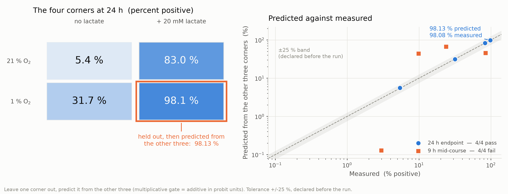
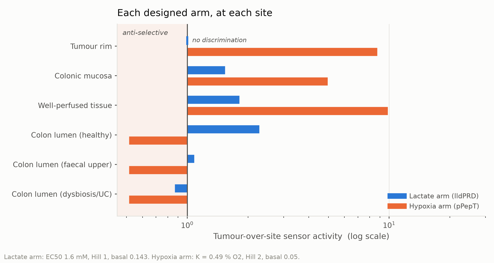
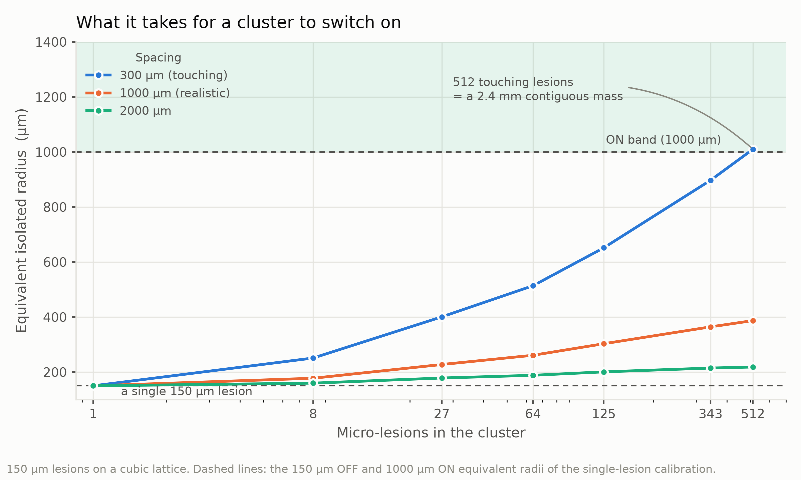

# Engineering — Modeling

> **交接说明（不上线，做 wiki 时删掉本块）**
>
> * 这是 **Engineering 页建模组的那一块**。湿实验的 DBTL（克隆、转化、共培养、
>   杀伤实验）是实验组自己写，不在这份稿子里。
> * 五轮循环，每轮四个小标题 **Design / Build / Test / Learn**，末尾一句
>   **Next iteration**。小标题请保留，奖牌标准看的就是这四个阶段。
> * 配图四张，文件在 `model_v2/outputs/figures/` 下，图号和路径：
>   1 `video/fig2_2_gate_holdout.png`｜2 `fig3_3_arm_direction.png`｜
>   3 `fig4_4_cluster.png`｜4 `fig4_6_dose_requirement.png`
> * **图注按诺诺比 2026-10-20 的要求写**，和 `Description_Modeling_Insert.docx`
>   同一套：`Figure n. 标题句.` **粗体不斜体**，后面说明**不粗不斜**；只陈述图里
>   有的事实（轴、标度、系列、色带、标注值），**不写推断**；正文第一次提到每张图
>   都带 `(Fig. n)`。**这三条请原样保留。**
> * 稿子里写的是 `{#gate}` `{#arms}` `{#cluster}` `{#dose}` 占位符，构建时按图注
>   出现顺序自动编号。**两种错误会直接让构建退出**：图注没人在正文里点名、正文点了
>   没有图注。如果这节在 wiki 上前面还有别的图，改 `build_engineering_html.py` 里的
>   `FIRST_FIGURE` 重新构建，**不要手改编号**。
> * ⚠️ **还没动的**：`fig3_3` 底部和 `fig4_6` 底部的副标题句仍是叙述式推断，严格按
>   "不推断"的尺子该从**图片内部**拿掉。改的是 `src/plots.py`，会同时影响 Model 页，
>   所以和 Description 那边一样留给合稿会一起定。
> * 公式编号 `(2.2-4)` 这种是本项目方程总表 `EQUATIONS.md` 的编号，**保留**，
>   上线时按 wiki 自己的编号重排也可以，但不要删。
> * 文中每个数字都是用 `src/` 的真函数复算过的，**不要手改数字**；要改先问建模组。
> * 本块以 `---` 结尾，构建脚本据此整块剥掉。

---

The modelling team built five models for this project. Each one existed to
change a decision, and this page records, for each, what we designed, what we
built, how we put it at risk, and what the answer changed.

Two of the five went through a full second iteration: the first version returned
an answer that looked perfectly reasonable, and testing it revealed that the
model had been asked the wrong question rather than asked it badly.

---

## Cycle 1 — The AND gate: from assumption to prediction

### Design

Our circuit is an AND gate: hypoxia drives `LuxI` from `pPepT` to make AHL,
lactate drives `LuxR` from the native `lldPRD` promoter, and only the LuxR–AHL
complex opens `pLux`. The whole safety analysis wants to treat that gate as a
**product of its two arms**, because then every tissue site scores as a product
of two independent numbers instead of a surface that would have to be measured
everywhere.

The honest form of the question is not *is it multiplicative?* but **could we
find out that it is not?**

### Build

A factorised gate, plus a **leave-one-corner-out protocol**. Working in log-odds
$z$, multiplicativity is the statement that the two-way interaction vanishes:

$$\Delta z_{AB} - \Delta z_{A} - \Delta z_{B} \;=\; 0 \tag{2.2-4}$$

The four reporter corners — 21 % / 1 % O₂ × ± 20 mM lactate — are exactly the
2 × 2 this is defined on, so Eq. (2.2-4) rearranges into a **prediction**: hold
out any one corner and the other three determine it.

$$z_D \;=\; z_B + z_C - z_A$$

Both decision criteria — a ratio bound and a standard-error bound — were
declared **before** the protocol was run, so a pass could not be chosen
afterwards.

### Test

Each corner was held out in turn and predicted from the other three
(Fig. {#gate}). At the 24 h endpoint **all four passed**, and the fully-on
corner — the state the circuit is designed to reach, and so the one that matters
— came out within **0.05 percentage points** of its measured value.

We then ran the identical protocol at the mid-course sampling points, expecting
it to fail. It did. At 9 h **not one of the four corners passed**, the worst
missing by **4.447×**. At 6 h none passed the ratio bound either, the worst at
1.600×, although all four stayed inside the standard-error bound — which is why
both criteria were declared in advance, and why neither on its own would have
been enough.

**Figure {#gate}. Leave-one-corner-out test of the AND gate at 24 h and at 9 h.**
Left: the four reporter corners at 24 h, 21 % or 1 % O₂ against 0 or 20 mM
lactate, each cell labelled with its percentage of GFP-positive cells and shaded
by that value; the outlined cell is the corner held out, and the annotation below
it gives the value predicted from the other three. Right: predicted against
measured for every held-out corner, both axes logarithmic, with the dashed
identity line and the grey ±25 % band declared before the run. Circles are the
24 h endpoint and squares the 9 h mid-course; the legend gives the pass count for
each. Percentages are replicate means taken in probit units and mapped back.

### Learn

**The AND claim is now an out-of-sample result, not an internal check.** The
corner the model had never seen was predicted to 0.05 percentage points. That
licenses the rest of this page to factorise the gate.

**The failure is the more valuable half.** A protocol that passes everything has
no discriminating power and proves nothing. Ours rejects: at 9 h it misses by up
to 4.4×, using the same equations and the same data. That is why the 24 h pass
means something.

**So the validity domain is explicit, and narrower than we assumed.**
Factorisation holds **at the endpoint only**, and we wrote a standing
prohibition against extrapolating mid-course ON/OFF ratios into any site score.
One licence and one restriction, from one experiment.

### Next iteration

This is internal cross-validation — there is one dataset, so it cannot be
external validation and we do not call it that. The next version needs a second
dataset; the cheapest candidate is the lactate gradient in Cycle 5.

---

## Cycle 2 — The tissue-site model: the site list was the bug

### Design (v1)

Cycle 1 established that the gate factorises, so each site can be scored as a
product of arms. The question this model exists to answer: **at which
non-tumour sites are the inputs simultaneously true?**

### Build (v1)

Two monotone sensor responses — lactate induces, oxygen represses:

$$f_L(L) = b_L + (1-b_L)\,\frac{L^{\,n_L}}{EC_{50}^{\,n_L}+L^{\,n_L}} \tag{3.1-1}$$

$$f_{O}(C) = b_{O} + (1-b_{O})\,\frac{K_{O_2}^{\,n_O}}{K_{O_2}^{\,n_O}+C^{\,n_O}} \tag{3.1-2}$$

combined into a site score relative to the tumour core:

$$\mathcal R(\text{site}) =
\underbrace{\frac{f_L(L_t)}{f_L(L_s)}}_{\text{lactate arm}}\cdot
\underbrace{\frac{f_O(C_t)}{f_O(C_s)}}_{\text{hypoxia arm}}\cdot
\underbrace{\left(\frac{f_O(C_t)N_t}{f_O(C_s)N_s}\right)^{n_Q}}_{\text{quorum arm}}\cdot
\underbrace{\rho_{\text{anox}}\rho_{\text{glu}}}_{\text{native repression}} \tag{3.1-4}$$

with a site table giving lactate and oxygen per site, each with bounds, a
literature source and an evidence grade.

### Test (v1)

We scored every site on the list — tumour rim, colonic mucosa, well-perfused
tissue — against the tumour core, and swept the quorum Hill coefficient over its
whole plausible range rather than trusting one value. Every site came out in the
tumour's favour, with margin to spare, across the whole sweep. **By its own
criterion the model passed, and we were ready to report it.**

### Learn (v1)

Then someone asked what was *on* the list. The answer was: the sites we had
inherited — and **no gut lumen**. The delivery route is oral, so the colonic
lumen is where this organism spends most of its life, and it was the one place
the model had never been asked about. A site list that leaves out the organism's
own habitat returns a reassuring answer whatever the equations do.

**The bug was not in the equations. It was in the list of things the model was
asked about** — the most dangerous kind, because nothing in the output looks
wrong.

### Design (v2)

The v1 Learn located the fault in the site list, not in the equations — so the
v2 design changes the list and nothing else. **Eqs. (3.1-1), (3.1-2) and (3.1-4)
are kept exactly as they were**, deliberately: if the answer moves, we need to
be able to say it moved because of the sites we added, and not because we
re-tuned a model at the same time.

What goes in are the luminal sites, with their real numbers. A healthy rectal
lumen carries
about 0.5 mM L-lactate (range 0–1.6) and 0.1 mM D-lactate (0–0.8) (Crit Care
2006, PMC1794470), and healthy faeces stay below 5 mM (Duncan et al., AEM 2004).
Against the tumour reference of 8 mM those look harmless. But in ulcerative
colitis or short bowel syndrome luminal lactate reaches **100 mM** (Mayeur et
al., PLoS ONE 2013; Hove & Mortensen 1994) — **twelve times the tumour value**,
and that is the case the first site list never asked about.

### Build (v2)

The same scoring code, re-run over the extended site table. No parameter was
re-fitted and no term was added; the only difference from v1 is four more rows,
each with its own bounds, literature source and evidence grade.

### Test (v2)

Analytically first. Both arms are monotone in their own stimulus, so the lactate
arm's discriminating power has a closed-form ceiling — set either by the
concentration ratio or by basal expression, whichever binds first:

$$\text{discrimination} \;\le\; \min\!\left(\left(\frac{L_\text{target}}{L_\text{off-target}}\right)^{n_L},\; \frac{1}{b_L}\right)$$

Wild-type `lldPRD` has $b_L \approx 1/7$, so **the lactate arm cannot
discriminate better than 7×, for any Hill coefficient and any EC50.** No amount
of tuning rescues it.

Then numerically, on the designed arms alone (Fig. {#arms}):

* The colonic lumen is **anoxic (0 % O₂)**; a tumour core is merely **hypoxic
  (≈0.5 %)**. By Eq. (3.1-2) the hypoxia arm is **counter-selective** at all
  three luminal sites.
* Under dysbiosis, luminal lactate reaches **12× the tumour value** — so **both
  arms are counter-selective at once**.
* All three luminal sites score **below 1.0**: the gate prefers the gut to the
  tumour.

**Figure {#arms}. Tumour-over-site output ratio of each designed sensor arm at
six off-target sites.** Each pair of bars gives the ratio of that arm's output in
the tumour core to its output at the site named on the left, on a logarithmic
axis: blue is the lactate arm, orange the hypoxia arm. The vertical line marks a
ratio of 1, labelled "no discrimination", and the shaded band to its left marks
ratios below it, labelled "anti-selective"; where a ratio is 1 a tick replaces
the bar. The native lldPRD repression is not included in either arm. The lactate
arm is drawn at EC50 1.6 mM and Hill 1, the hypoxia arm at K = 0.49 % O₂ and
Hill 2.

### Learn (v2)

**The circuit survives, because of a property of the part we had not been
crediting.** `BBa_M36021` is the **native** *E. coli* `lldPRD` operon promoter,
so its anaerobic and glucose repression are intact — the
$\rho_{\text{anox}}\rho_{\text{glu}}$ term of Eq. (3.1-4), which we had been
carrying as 1. The colonic lumen is anoxic and proximally glucose-rich; a tumour
core is hypoxic-but-not-anoxic and glucose-depleted by the Warburg effect. The
repression therefore **engages in the lumen and releases in the tumour**: 87–228×
luminal discrimination, where the designed arms alone give 0.87–2.28×. The worst
site needs only ≈12-fold repression.

**🔴 This reversed a planned build decision.** Our July route-map said *"replace
with a lactate sensor optimised for hypoxic, glucose-rich conditions"* — i.e.
swap in a de-repressed variant to raise intratumoural expression. **That would
delete the $\rho_{\text{anox}}\rho_{\text{glu}}$ term, which is the only thing
holding the colonic lumen off.** We rejected the optimisation.

**And one claim here needs no calibration at all.** With $d_{O_2}$ the oxygen
penetration depth, the hypoxic core radius and volume fraction are pure
geometry:

$$r_{\text{core}}(R) = \max\!\big(R-d_{O_2},\,0\big),\qquad
\phi_{\text{hyp}}(R) = \left(\frac{r_{\text{core}}(R)}{R}\right)^{3} \tag{3.2-1}$$

from which, immediately:

$$R<d_{O_2}\ \Longrightarrow\ \phi_{\text{hyp}}(R)\equiv0\ \Longrightarrow\
\bar f_O(R)\equiv f_O(C_{\text{rim}})=\text{const} \tag{3.2-5}$$

We take $d_{O_2} = 178$ µm. **A lesion smaller than 178 µm has no hypoxic volume
at all, so the hypoxia arm cannot fire — for any parameter set, any sensor, any
calibration.** It is also the one number in the project an *independent*
measurement confirms: 178 µm falls inside the 160–200 µm bracket Thomlinson &
Gray measured histologically in 1955, by a different method on different tissue.

> A note on what this cycle does **not** rest on. We had internally reported a
> protein-level selectivity index of 11.4× for the effector; checking it against
> our own data conventions showed it was built from a numerator and a denominator
> measured in two different experiments, and we withdrew it. The only valid
> figure is **3.33×** (4.77 ± 0.80 / 1.43 ± 0.49, n = 3, p < 0.001), paired
> within one experiment. **So the safety argument has to come from the circuit's
> tissue selectivity — this cycle — and not from any preference the effector has
> for cancer cells.**

### Next iteration

The v2 conclusion rests on one unmeasured quantity: whether $\rho_{\text{anox}}$
really is small at 0 % O₂ and ≈1 at 1 %. That is Cycle 5, and it is the only
open item we would call load-bearing.

---

## Cycle 3 — The multi-lesion model we did not need to build

### Design (v1)

Micro-metastases occur in clusters, and AHL from neighbouring lesions might push
a cluster over a quorum threshold that no single lesion reaches. We specified a
**2D axisymmetric finite-difference model** on a diffusion–reaction grid.

### Build (v1)

We started the grid and stopped partway. Writing the steady state down in order
to discretise it is what exposed the problem — the equation we were about to
spend a week approximating is this one:

$$D\nabla^2 C-\delta C+q(\mathbf x)=0 \tag{4.4-1}$$

### Test (v1)

Before discretising anything we checked the one thing a converged grid can never
tell you afterwards: whether Eq. (4.4-1) needs a grid at all. The test is a
single question put to the source term — **does $q$ depend on $C$?** — because
if it does not, the equation is linear and the numerical scheme is redundant.

### Learn (v1)

**`LuxI` sits on `pPepT`, not on `pLux`.** There is therefore no AHL
autoinduction feedback, so $q$ does not depend on $C$, and Eq. (4.4-1) is
**linear** — which means **superposition is exact**.

With $\lambda=\sqrt{D/\delta}$ and $\alpha=R/\lambda$, a single spherical source
has a closed-form centre value:

$$\Psi_{\text{centre}}(R)=1-(1+\alpha)e^{-\alpha} \tag{4.4-3}$$

So summing closed-form single-sphere solutions over an arbitrary 3D arrangement
is not an approximation to the finite-difference answer — **it is the answer**,
and the 2D grid would have been the approximation. Cheaper to compute and *more*
accurate, in one move.

### Design (v2)

The v1 Learn removed the reason for the grid, so the v2 design removes the grid.
Since $q$ is independent of $C$, superposition is exact, and the design becomes:
evaluate the closed-form single-sphere solution at every source and add the
contributions over whatever arrangement we want to ask about.

### Build (v2)

A few lines over an array of sphere centres — no mesh, no convergence study, no
time stepping. That cheapness is itself a result: the v2 model is quick enough
to sweep every cluster size and spacing we care about, which the grid would not
have been.

### Test (v2)

Equivalent isolated radius for clustered 150 µm micro-lesions, against our own
150 µm OFF → 1000 µm ON bracket (Fig. {#cluster}). Packed touching, at 300 µm
spacing, thirteen lesions behave like a single lesion of 333 µm and 125 of them
like one of **652 µm**. At the realistic 1000 µm spacing the same two clusters
fall to 207 µm and 303 µm, and at 2000 µm to 173 µm and 201 µm.

**Figure {#cluster}. Equivalent isolated radius of a cluster of 150 µm
micro-lesions against the number of lesions in it.** Clusters of 1 to 512 lesions
are arranged on a cubic lattice at three centre-to-centre spacings, one series
each; the horizontal axis is logarithmic. The two dashed lines are the 150 µm OFF
and 1000 µm ON equivalent radii of the single-lesion calibration, and the shaded
band above the upper one is labelled "ON band". The annotation records that the
512-lesion touching cluster is a 2.4 mm contiguous mass.

### Learn (v2)

**No cluster reaches 1000 µm.** Reaching it would take 512 touching lesions — a
continuous 2.4 mm mass, which is no longer a micrometastasis.

**Dispersal is always worse than aggregation, and the closed form says why.** In
the small-$\alpha$ limit the two contributions scale differently:

$$\underbrace{\Psi_{\text{centre}}\sim\frac{\alpha^2}{2}}_{\text{self}\ \propto\ R^2}
\qquad\text{vs}\qquad
\underbrace{\Psi_{\text{out}}\sim\frac{R^3}{3\lambda^2 d}}_{\text{neighbour}\ \propto\ R^3/d} \tag{4.4-8}$$

Split a volume into smaller pieces and the self term falls faster than the
neighbour term compensates — 0.84–0.95× equivalent-over-equal-volume. A
numerical grid would have produced this number without producing the reason.

**The quorum module is a colonised-volume integrator, not a bistable switch.**
Because there is no autoinduction there is no hysteresis and no switch-like
transition, only a graded response. Every informal description of the circuit we
had used the word "switch".

**This redirected the project.** On safety, the 178 µm floor survives extension
to many lesions and gets harder. On efficacy, **this circuit cannot clear true
micrometastases** — distal killing can only come from the immune cascade, which
is why our immune module is not optional decoration but the only mechanism that
addresses disseminated disease.

### Next iteration

Superposition assumes identical spherical sources, and real lesion size
distributions are broad. A v3 would carry a size distribution rather than a
single radius. The conclusion is robust to this — dispersal already loses by
Eq. (4.4-8) — so we did not prioritise it.

---

## Cycle 4 — The dose model: changing the question

### Design

Dose had only ever been asked as a **potency comparison** — which construct
kills more. That is not an engineering specification. We reframed it: **what
fraction of a lesion must be cleared per day for the lesion not to grow**, and
what dose delivers that?

### Build

A closed-form criterion that assumes **no dose–response shape** — it follows
from the doubling time alone:

$$f \;=\; 1 - \exp\!\left(-\frac{\ln 2 \cdot 24}{T_\text{doubling}}\right)$$

plus a power-law fit to the measured dose series with the **plasmid control
subtracted** (at the top dose the chassis accounts for 27 % of the raw reading).

### Test

Leave-one-out, against the same pre-declared criteria as Cycle 1. All **six**
held-out doses passed, the worst at 0.835×. Separately, all **eight** 24 h
capacity values forecast from the first 12 hours passed, running 0–8 % high with
a mean bias of 1.0500.

With Cycle 1's corners, that is **28 held-out predictions** in total.

**Figure {#dose}. Dose–kill relation, and the escalation and remaining margin
against lesion radius.** Left: net CT26 killing over 24 h against co-culture
dose, logarithmic axes. Points are measurements net of the GFP control with
standard-error bars, the shaded band the doses tested, the line a power-law fit
of exponent 2.65, and the horizontal bands the target effect sizes, 0.12–0.69 %
(human) and 29.3–50 % (CT26). Right: fold change against lesion radius,
logarithmic — circles the escalation that radius needs, squares the
colonic-mucosa margin left, priced on 21.85-fold. The dashed line at 10 is the
required margin, that at 1 none left, the dotted vertical at 178 µm the smallest
radius with a hypoxic core; the circled 150 µm point reads 4.95-fold dose,
4.41-fold margin left.

### Learn

Killing follows a near-cubic dose law (Fig. {#dose}): killing ∝ dose^b, with
b = 2.65–3.38 and r² > 0.995.

A CT26 lesion, doubling every 24–48 h, has to lose 29–50 % of itself a day,
which on that relation costs **1.30–1.76×** the highest dose we tested — more
than we have. Human colorectal cancer doubles in 100–600 days and needs only
**0.12–0.69 %**, which costs **0.18–0.43×** — **already met below the lowest
dose tested**.

**The human half does not depend on the fit at all.** Measured net killing at
the *lowest* dose is 2.97 % against a requirement of 0.69 % — a direct
comparison, exceeding it 4.3×. All three measured doses satisfy the clinical
indication. CT26 doubles two orders of magnitude faster than human CRC, so
"insufficient in mice" does not imply insufficient in humans; it means the mouse
is the harder target.

**The cubic law takes the cube root of every unknown.** A 600-fold spread in
doubling time becomes a 9.9-fold spread in required dose, and the 3.7-fold
delivery loss from spatial coverage needs only 1.64-fold dose compensation. This
back-calculation is **least** sensitive to its most uncertain parameter, which is
the opposite of the usual situation.

### Next iteration

The criterion treats a lesion as well-mixed. Coupling it to Cycle 3's spatial
result is the obvious v2: at 150 µm the required escalation is 4.95×, which
leaves only 4.41× of the mucosal margin — so dose and safety stop being
independent. That coupling is stated but not yet modelled jointly.

---

## Cycle 5 — Open: anoxia vs. hypoxia at the lactate sensor

We report this one unfinished, because the alternative is to overstate Cycle 2.

### Design

Cycle 2's safety conclusion rests on the $\rho_{\text{anox}}$ term of
Eq. (3.1-4): that native `lldPRD` anaerobic repression is **engaged at 0 % O₂**
(gut lumen) and **released at ~1 % O₂** (tumour core). This is the single
structural assumption in the project, and it is not in the same class as our
other open parameters:

> Every other unmeasured parameter only widens an interval.
> **This one changes a sign.**

On the full-gate measure, with repression the three luminal sites score 23–60×;
without it, **0.23–0.60×** — which also flips which element is the bottleneck,
and flips Cycle 2's "do not swap the promoter" recommendation.

* **The measured half:** 1 % O₂ + lactate is the highest of the four corners
  (98.1 %, Fig. {#gate}), so the sensor is *not* repressed at 1 %, which is what
  the tumour side requires.
* **The unmeasured half:** our dataset contains **no 0 % O₂ condition at all.**
* **Why we nonetheless think it holds** (neither reason is a measurement): the
  required repression is modest — 4.4× / 9.2× / 11.5× at the three sites — and
  the switching range of FNR-type oxygen regulation is 0–1 %, exactly the
  interval separating the two sites.

### Build — specified, not yet run

An `lldPRD`-only reporter construct, assayed at 0 % and at 1 % O₂ with lactate
held at the tumour value. Nothing else varies between the two conditions, so
their ratio *is* $\rho_{\text{anox}}$ — the term Cycle 2 had to carry as an
assumption.

### Test — the decision rule, declared now

> **One plate closes it: `lldPRD`-only reporter, 0 % vs 1 % O₂.**

We write the criterion down before the plate exists, for the same reason Cycle 1
declared its bounds in advance. A repression ratio above **11.5×** sustains
Cycle 2's conclusion at all three luminal sites. Below **4.4×** none of them
hold, and the recommendation not to swap the promoter has to be withdrawn.
Between the two the sites separate, and the page will say which ones survive.

### Learn — what specifying it has already settled

Two things, before any plate is poured. First, our global sensitivity analysis
picked out the same parameter independently as the cheapest and most valuable to
measure (`repression_fold`, ST = 0.457 at the bottleneck): two
methods, arrived at separately, pointing at one plate. Second, having to state
the criterion is what forced Cycle 2 to be written as a **requirement on the
parameter** rather than a claim about its value — which is what keeps that cycle
honest while this one stays open.

### Next iteration

Cycle 2 was deliberately written to ask **where the parameter must lie** rather
than to depend on a value we do not have. If the plate comes back as expected,
the v3 tissue model replaces an interval with a measurement; if it comes back the
other way, Cycle 2's recommendation inverts, and we have already written down
that it would.
