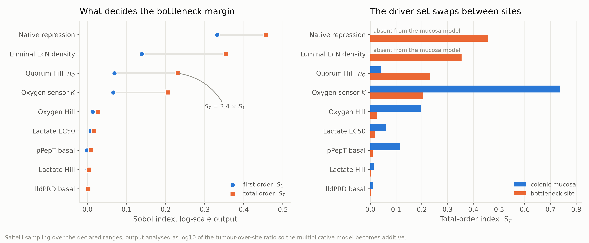

# 模块 3.5 — 全局灵敏度：安全余量的方差由谁支配

> **本模块要回答的问题**
> 1. 在声明的参数范围内，**瓶颈位点**的安全余量方差由哪几个参数支配？它们可测吗？
> 2. 9.23 报的三大驱动（`K_O2` 0.427、`n_Q` 0.23、`pept_basal` 0.174）能否被独立
>    实现复现？
> 3. 模块 3.1 指出的"乳酸先验之争"（抬高 5–14×）到底**决不决定**安全结论？
> 4. 安全性论证在声明范围的多大比例内成立？失败时是哪个位点先失败？
>
> 对应导师意见：**总评第一项**（AND 门的安全性）。本模块是第 3 章的**收口**：
> 3.1–3.4 各自给出点估计，这里回答"这些点估计靠哪几个参数吊着"。

运行：`.venv/bin/python -m pytest tests/test_sensitivity.py -q`（13 条断言）
图：`outputs/figures/fig3_5_sobol_drivers.png`
方程编号：见 [`EQUATIONS.md`](EQUATIONS.md) §3.5

---

## 1. 模型假设

| # | 假设 | 类型 | 依据 |
|---|---|---|---|
| A1 | 输出取 $\log_{10}$ 后再做方差分解 | **protocol，方法学核心** | 组织比值是连乘；见 §2.1 的论证 |
| A2 | 9 个参数在声明区间内**独立均匀**采样 | 声明 | 区间来源见 §3；先验是**范围不是分布** |
| A3 | 输出之一是"瓶颈"$=\min_{\text{site}}\mathcal R$ | 声明 | 安全性由最弱一环决定，不由平均位点决定 |
| A4 | 采样覆盖模块 3.1 发现的先验之争 | 声明 | 乳酸三参数的区间横跨本项目已发表值与 9.23 的宽松值 |
| A5 | 覆盖率**不是**任何校准意义上的概率 | 声明 | 由 A2，它是对声明范围的覆盖率陈述 |

---

## 2. 方程

### 2.1 为什么必须用对数尺度

组织比值是式(3.1-4)，一个**连乘**：

$$\mathcal R=\text{lac}\times\text{hyp}\times\left(\frac{\text{hyp}}{d}\right)^{n_Q}\times R$$

原始尺度下，方差被"乘性范围最宽的那个因子"主导，而且几乎所有东西都显示为"交互"
——因为乘积本来就非线性。取 $\log_{10}$ 把连乘变成求和：

$$\log\mathcal R=\log\text{lac}+\log\text{hyp}+n_Q\log\frac{\text{hyp}}{d}+\log R \tag{3.5-2}$$

**纯乘性模型在对数尺度上应当交互为零、一阶指数之和为 1。** 这让分析从描述性变成
**诊断性**：对数尺度上**幸存**的交互是真实耦合，不是乘法的假象。

式(3.5-2) 里恰好只有**一个**真实耦合——$n_Q$ 乘在 $\log(\text{hyp}/d)$ 上。
所以可以**事先预测**：$n_Q$ 应当有不大的一阶指数、但大得多的总阶指数。

### 2.2 Sobol 分解

$$\mathrm{Var}[\log\mathcal R]=\sum_i V_i+\sum_{i<j}V_{ij}+\cdots$$

$$S_i=\frac{V_i}{\mathrm{Var}[\log\mathcal R]},
\qquad
S_{Ti}=1-\frac{V_{\sim i}}{\mathrm{Var}[\log\mathcal R]} \tag{3.5-1}$$

**两个指数要一起读**：$S_i$ 是"它自己把输出推了多少"，$S_{Ti}$ 是"它连同与它耦合的
一切推了多少"。**$S_T\gg S_1$ 的参数，决定的是"其他参数有多要紧"。**

可加性检验量与交互占比：

$$\textstyle\sum_i S_i\ \ (\to 1\text{ 为完全可加}),
\qquad
\text{interaction share}_i=1-\frac{S_i}{S_{Ti}} \tag{3.5-3}$$

---

## 3. 参数与符号

**9 个采样参数及区间来源**（`sensitivity.PROBLEM`，区间即其 provenance）：

| # | 参数 | 区间 | 区间来源 |
|---|---|---|---|
| 1 | `ec50_lactate_mM` | 0.5 – 5.0 | 已发表 1.6 mM 至 9.23 先验 5.0（**覆盖先验之争**） |
| 2 | `hill_lactate` | 1.0 – 2.0 | LldR 无报道协同性；9.23 假设 2 |
| 3 | `basal_lactate` | 0.001 – 0.20 | 9.23 的 0.0078 至已发表的 ~1/7 |
| 4 | `k_o2_percent` | 0.3 – 3.0 | 围绕共用的 1 % O₂ 先验 |
| 5 | `hill_o2` | 1.0 – 3.0 | 围绕共用的 $n_O=2$ |
| 6 | `basal_o2` | 0.02 – 0.20 | pPepT 基础；9.23 拟合 0.122 |
| 7 | `n_Q` | 1.0 – 3.0 | 9.23 两套标定：1.0 与 2.978 |
| 8 | `lumen_density_ratio` | 0.1 – 10.0 | 肠腔 EcN 密度/瘤内，**完全未测** |
| 9 | `repression_fold` | 1.0 – 30.0 | 天然厌氧/葡萄糖抑制，**各**一项 |

**三个输出**：`colonic_mucosa`（9.23 分析的那个）、`colon_lumen_dysbiotic`、
`bottleneck`（A3，各位点取最小）。

| 采样设置 | 值 |
|---|---|
| 采样器 | Saltelli（SALib `sobol_sample`） |
| $n_{\text{base}}$ | 1024 |
| 二阶指数 | 关闭（`calc_second_order=False`） |
| **总样本数** | $1024\times(9+2)=\mathbf{11{,}264}$ |
| 随机种子 | **20261008**（固定，结果可复现） |

---

## 4. 代入与求解

### 4.1 可加性检验：§2.1 的预测被证实（式 3.5-3）

| 输出 | $\sum S_1$ | $\sum S_T$ | 残余交互 |
|---|---|---|---|
| 结肠黏膜 | 0.8405 | 1.1739 | 0.1595 |
| 结肠腔（失调） | **0.9173** | 1.0320 | **0.0827** |
| **瓶颈** | 0.6248 | 1.3079 | **0.3752** |

单位点几乎可加（残余 8–16 %），**符合对数变换应有的效果**。瓶颈输出残余 37.5 %——
因为 A3 的"取最小值"**本身就是真正的非线性操作**，不是乘法假象。这正是 §2.1 所说的
"幸存的交互是真实耦合"。

$n_Q$ 的签名也如预测：

| 输出 | $n_Q$ 的 $S_1$ | $S_T$ | 交互占比 |
|---|---|---|---|
| 结肠黏膜 | 0.0134 | 0.0420 | **0.68** |
| 结肠腔（失调） | 0.0895 | 0.1493 | 0.40 |
| 瓶颈 | 0.0688 | 0.2314 | **0.70** |

> **$n_Q$ 的 $S_T$ 是 $S_1$ 的 3.4 倍（瓶颈处），意味着它决定的是"其他参数有多要紧"。**
> 这正好解释模块 3.1 §5.2 和 3.2 §5.3 的发现：两个头条范围（22–910×、14–6891×）
> **都是 $n_Q$ 通过幂律放大其他不确定性的结果**。9.23 只报一种指数，看不到这个结构。

### 4.2 结肠黏膜：9.23 的结论被独立确认

| 参数 | $S_1$ | $S_T$ | 交互占比 |
|---|---|---|---|
| **`k_o2_percent`** | **0.5873** | **0.7365** | 0.20 |
| `hill_o2` | 0.1106 | 0.1975 | 0.44 |
| `basal_o2` | 0.0603 | 0.1143 | 0.47 |
| `ec50_lactate_mM` | 0.0534 | 0.0605 | 0.12 |

**前三名全是氧传感器参数。** 头名与 9.23 一致（其 `K_O2_uM` 0.427），第三名
`basal_o2` 就是它的 `pept_basal_fraction`（0.174）。**两套独立实现得到同一结论。**

### 4.3 瓶颈位点：由 9.23 模型里根本不存在的两个参数驱动

> 左图是 $S_1$ 与 $S_T$ 的间距——**间距本身就是要看的量**：$S_T\gg S_1$ 的参数决定
> 其他参数有多要紧，而不是它自己把输出推了多少。右图是黏膜与瓶颈的 $S_T$ 对照，
> **两套驱动几乎不重叠**。

结肠腔（失调）：

| 参数 | $S_1$ | $S_T$ | 交互占比 |
|---|---|---|---|
| **`lumen_density_ratio`** | **0.4383** | **0.4831** | 0.09 |
| **`repression_fold`** | **0.3312** | **0.3324** | **0.004** |
| `n_Q` | 0.0895 | 0.1493 | 0.40 |
| `k_o2_percent` | 0.0564 | 0.0608 | 0.07 |

瓶颈（全局）：

| 参数 | $S_1$ | $S_T$ | 交互占比 |
|---|---|---|---|
| **`repression_fold`** | 0.3317 | **0.4568** | 0.27 |
| **`lumen_density_ratio`** | 0.1386 | **0.3548** | 0.61 |
| `n_Q` | 0.0688 | 0.2314 | 0.70 |
| `k_o2_percent` | 0.0659 | 0.2055 | 0.68 |

> **这两个参数在 9.23 的 Sobol 里完全不存在**——因为它的模型没有肠腔位点。
> **它分析的是"次要位点由什么驱动"，而真正的瓶颈在它的视野之外。**

`repression_fold` 的交互占比只有 **0.004**——它在式(3.5-2) 的对数和里是个**纯加项**，
符合它作为乘性抑制因子的身份。**这是方法自洽性的一个旁证**（如果它出现大交互，
说明实现有错）。

### 4.4 乳酸先验之争不决定安全性

模块 3.1 §5.3 指出 9.23 的乳酸先验把乳酸臂抬高 5.2–14.5×。但在瓶颈位点：

| 参数 | $S_T$（瓶颈） | $S_T$（失调腔） |
|---|---|---|
| `ec50_lactate_mM` | **0.0172** | 0.0013 |
| `hill_lactate` | **0.0033** | 0.0002 |
| `basal_lactate` | **0.0021** | 0.0000 |

**三个乳酸参数在瓶颈的总阶指数都低于 0.02**（远低于 0.1）。原因：失调肠腔乳酸
100 mM，**两套先验都饱和**。

> 所以模块 3.1 的更正重要在"**不能用宽松先验讲故事**"，而不是"它改变了安全结论"。
> 这两件事必须分开说。

### 4.5 声明范围内的覆盖率

| 位点 | 保持保护性的比例 | $\log_{10}\mathcal R$ 中位数 | 5 % 分位 |
|---|---|---|---|
| 瘤缘 | **1.0000** | 1.385 | 0.654 |
| 灌注良好组织 | **1.0000** | 2.243 | 1.345 |
| 结肠黏膜 | **0.9922** | 0.681 | 0.157 |
| 结肠腔（健康） | 0.8804 | 1.424 | **−0.593** |
| 结肠腔（粪便） | 0.7769 | 0.861 | **−1.143** |
| 结肠腔（失调） | 0.7442 | 0.728 | **−1.266** |
| **瓶颈** | **0.7394** | 0.361 | **−1.266** |

---

## 5. 结果

### 5.1 ⭐ 瓶颈的两个驱动参数，一个未测、一个占位

$S_T$ 排序：`repression_fold` **0.457** > `lumen_density_ratio` **0.355** >
$n_Q$ 0.231 > `k_o2_percent` 0.206。

这把第 3 章的全部不确定性收敛到两个量上，**而它们恰好都不是实测值**：

| 参数 | 状态 | 对应模块 | 最便宜的定案实验 |
|---|---|---|---|
| `repression_fold` | scenario 占位（0.1 各） | `MODULE_3_3.md` §4.5 | **一块板**：`lldPRD`-only，0 % vs 1 % O₂ |
| `lumen_density_ratio` | **完全未测** | `MODULE_3_1.md` §5.4 | 需动物实验（本周期做不了） |

**这是本模块对实验组最有用的一句话**：第 3 章的方差有 81 %（0.457 + 0.355）压在这两个
参数上，其中第一个用一块板就能定案。

### 5.2 安全性论证在声明范围的 73.9 % 内成立，且每一次失败都是肠腔失败

组织位点几乎永远安全（黏膜 99.2 %，瘤缘与灌注良好组织 100 %）。
**全部失败都发生在三个肠腔位点**，与模块 3.3 的结构性结论（式 3.3-1）完全一致——
两条路径独立指向同一处薄弱点。

⚠️ **这不是任何校准意义上的概率**（A5）。先验是范围不是分布，所以 73.9 % 是对**声明
范围**的覆盖率陈述。换一组区间就换一个数字，区间来源全部列在 §3。

### 5.3 对 9.23 的处理

| 9.23 的说法 | 本模块 |
|---|---|
| `K_O2` 是 tumour-vs-mucosa 头号驱动（0.427） | ✅ **独立确认**（$S_T$ 0.7365，前三全是氧参数） |
| `pept_basal_fraction` 第三（0.174） | ✅ 确认（本模块 `basal_o2`，$S_T$ 0.1143） |
| `n_Q` 0.23 | ✅ 确认其重要性，并给出**结构**：$S_T\gg S_1$，它决定其他参数有多要紧 |
| 原始尺度、单一指数 | ❌ 改为**对数尺度 + $S_1/S_T$ 双指数**，使交互可诊断 |
| 只分析了次要位点 | ❌ **补齐瓶颈位点**；真驱动是 `repression_fold` 与 `lumen_density_ratio`，**均不在其模型中** |
| （未报告） | 🆕 乳酸先验之争不决定安全性（瓶颈 $S_T<0.02$） |
| （未报告） | 🆕 覆盖率 73.9 %，**全部失败均为肠腔失败** |

---

## 6. 边界与局限

1. **A2（独立均匀）是最简选择**，不是知识的真实反映。$n_Q$ 的两个标定值 1.0 与
   2.978 并非等可能；`repression_fold` 的真实分布大概偏向大值（文献称"强抑制"）。
   均匀采样在这两处**偏保守**。
2. **A5：覆盖率不是概率。** 73.9 % 不可写成"安全性有 73.9 % 的概率成立"。
3. **二阶指数未算**（`calc_second_order=False`），所以能说"存在交互、有多大"，
   不能说"是哪两个参数在交互"。瓶颈处 37.5 % 的残余交互因此只能归因到 A3 的
   $\min$ 操作上——这是推理，不是测量。
4. **瓶颈处个别 $S_1$ 为轻微负值**（`basal_lactate` −0.0001、`basal_o2` −0.0013）。
   这是 Sobol 估计量在指数接近 0 时的正常数值噪声，应读作"等于 0"，其
   `interaction_share` > 1 是同一现象的副产品，无意义。
5. **本模块只分析第 3 章的组织轴**，不覆盖第 4 章的剂量链。模块 4.6 的指数 $b$ 的
   不确定性（2.651–3.376）是**结构性选择**而非采样区间，不适合放进同一个 Sobol。
6. **采样范围内不含那个二值假设**（肠腔厌氧 / 瘤核不厌氧）。它不是可采样参数，而是
   会让结论**变号**的开关——见 `MODULE_3_3.md` §6.1。**本模块的 73.9 % 完全建立在它
   成立之上。**

---

## 7. 结论

对应 §0 的四问：

1. **瓶颈方差的 81 % 压在两个参数上**：`repression_fold`（$S_T$ 0.457）与
   `lumen_density_ratio`（0.355）。**前者用一块板就能定案**（0 % vs 1 % O₂），
   后者需动物实验。$n_Q$ 与 `k_o2_percent` 各约 0.21–0.23，且都是 $S_T\gg S_1$ 型。
2. **9.23 的三大驱动全部被独立复现**（$K_{O_2}$ 头名、`pept_basal` 第三、$n_Q$ 重要），
   但它分析的黏膜**不是**瓶颈位点——真瓶颈的两个驱动在它模型里根本不存在。
3. **乳酸先验之争不决定安全结论**（瓶颈 $S_T<0.02$，因 100 mM 下两套先验都饱和）。
   模块 3.1 的更正重要在"不能用宽松先验讲故事"，不在于它改变了结论。
4. **声明范围的 73.9 % 内安全性成立，且每一次失败都是肠腔失败**——与模块 3.3 的
   无参数结构性结论独立同向。组织位点几乎永远安全（黏膜 99.2 %，其余 100 %）。
5. **方法学结论**：对数尺度 + 双指数把这个连乘模型的灵敏度分析从描述性变成诊断性。
   单位点残余交互 8–16 %（应为 0），瓶颈 37.5 %（来自 $\min$ 操作），
   `repression_fold` 交互占比 0.004（纯加项）——三条都与式(3.5-2) 的结构预测一致，
   互为实现正确性的旁证。
