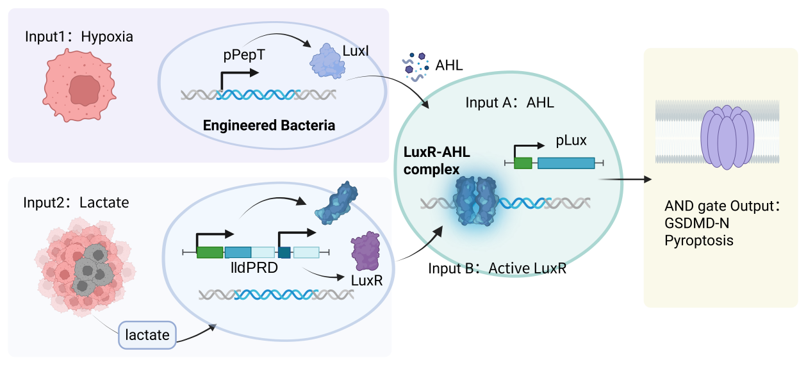
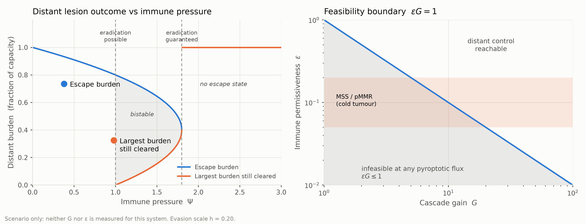

# Modeling

## What the model decided

Six things. Each is a decision the project took because of the number beside it,
not a description of a simulation. Everything after this page is the working.

**1 · Is the AND gate really a *product* of its two inputs?**
**Yes — at the endpoint.** The two-way interaction is zero within error at 24 h,
and the gate predicts any held-out corner to within 2.2 %. At 6 and 9 h the same
prediction is wrong by up to 4.4×.
→ *Licensed the entire safety chapter to factorise the gate, and forbade
extrapolating mid-course ON/OFF ratios* (§1.1, §4.1).

**2 · Where, other than a tumour, does the circuit switch on?**
**The colonic mucosa, at 21.85×** — and only because the *native* lldPRD
repressions hold the gut lumen off. On the designed arms alone, all three
luminal sites sit **below 1.0**.
→ *Found a bottleneck nobody had looked at: last cycle's site list had no lumen
in it at all* (§2.1).

**3 · Can we "improve" the lactate sensor by removing its glucose/anoxia repression?**
**No — that would destroy the safety argument.** Luminal discrimination falls
from 87–228× to 0.87–2.28×.
→ 🔴 *A design decision: do not swap in a de-repressed variant* (§2.3).

**4 · Below what lesion size can the hypoxia arm not fire, for *any* parameters?**
**≈178 µm.** Pure geometry, zero fitted parameters — and it lands inside the
160–200 µm bracket Thomlinson & Gray measured histologically in 1955.
→ *The hardest safety statement in the project, and the only parameter an
independent measurement confirms* (§2.2).

**5 · Keep the SsrA degron or drop it?**
**Keep.** All three doses clear the decision threshold, and ClpXP saturation
means the degron *amplifies* selectivity rather than merely damping output.
→ *Settled a build question the raw biomass numbers alone would have answered
backwards* (§2.4).

**6 · What dose does a therapeutic effect need?**
**The clinical indication is met below the lowest dose we tested; CT26 needs
1.3–1.8× the highest.** But reaching a 150 µm micro-lesion costs 4.95× and
leaves only 4.41× of the mucosa margin.
→ *Set the dose target, and showed micrometastasis is **not** a dose problem —
which is why §3.6 exists* (§3.4, §3.5).

**Every number on this page is computed, not transcribed.** The figures, the
tables and the worked substitutions are generated from the code in this
repository, and a test suite of 329 assertions pins each of them to the function
that produces it — so the page cannot hold a stale number, and a reader who
wants to check one can run it. §4 then puts the central claims through
out-of-sample tests: held-out gate corners, held-out doses, and a 24 h capacity
forecast built from truncated curves. All pass.

**Two of these results changed our own minds**, which is the part we would most
like a reader to weigh. §2.5 records two inherited sensor parameters that turned
out to have published measurements disagreeing with them; we adopted the
measurements and recomputed every number here. §5.1 withdraws a selectivity
index we had previously published, caught by our own consistency checking rather
than by anyone objecting.

---

## What we set out to answer

Two questions decide whether this design is worth building:

> **Safety — where, other than a tumour, does this circuit switch on?**
>
> **Efficacy — what dose would a therapeutic effect require?**

Everything below is organised under those two headings. We do not organise by
length scale, because a micro/meso/macro split describes the *model* rather than
the *decision*, and every section here exists to settle a decision.

The circuit:

**Figure 1.** The two-input AND gate. Hypoxia drives `LuxI` from `pPepT`;
lactate drives `LuxR` from the native `lldPRD` operon promoter; only the
LuxR–AHL complex opens `pLux` on the effector. Chassis is *E. coli* Nissle
1917, delivery is oral, and the indication is pMMR/MSS colorectal cancer. That
combination is not ours: orally dosed EcN selectively colonises adenomas in
*Apc*^Min/+^ mice and was enriched in tumour over normal tissue in a
double-blind trial of patients dosed before resection [@gurbatri2024], and EcN
replicates at the live/necrotic border of tumours while not colonising spleen or
liver at all [@stritzker2007]. The
lactate sensor is **BBa_M36021**, the native *E. coli* lldPRD operon promoter
[@bba_m36021], a choice that turns out to carry the whole luminal safety
argument (§2.3). Two things about that part are worth stating up front: it is a
332 bp basic part derived from `BBa_K822000`, and the Registry currently marks
it **deprecated**, which is a documentation status rather than a defect but is
the kind of thing a reader should hear from us rather than discover.

### How to read this page

Each section states the specific question it answers, then its governing
equations with every symbol defined, then the parameters with their units and
provenance, then the numbers substituted in, and only then the result. Where a
limitation changes a conclusion we say so next to that conclusion, and §5
collects the rest.

- **Equation numbers** run (1)…(N) in reading order. The source of this page
  tags each equation with its number in `EQUATIONS.md` instead, and the build
  emits the mapping to `outputs/equation_index.md`, so every formula here can
  still be traced to the function that evaluates it.
- **Evidence grades**: **calibration** = fitted to our data ·
  **literature prior** = measured by someone else on a comparable system ·
  **scenario** = a value we declared · **derived** = computed from other
  entries · **protocol** = a threshold fixed before it was used.
  The literature-prior grade separates "somebody measured this" from "we picked
  this", which the first four grades ran together.
- **Full parameter census** is in §6, generated from `config/parameters.csv`;
  `src/parameters.py` resolves each row against the constant the code actually
  uses and fails the test suite if the two disagree, so this page cannot hold a
  stale copy.

### Notation

The key mathematical notations used in this page are listed in Table 1. Every
symbol is also defined where it first appears, in the `where` list under each
section's equations.

**Table 1.** Notation.

| Symbol | Meaning |
|---|---|
| $f_L(L)$, $f_O(C)$ | lactate-arm and hypoxia-arm activity |
| $L$, $C$ | lactate concentration (mM), oxygen (% O₂, gas phase) |
| $n_Q$ | quorum Hill coefficient — the dominant unknown of the whole axis |
| $N$ | bacterial density (measured carrying capacity) |
| $R_{\text{margin}}$ | gate output at a site relative to the tumour core (the "margin") |
| $R$ | lesion radius (µm) |
| $\lambda$ | diffusion screening length (µm), $\lambda=\sqrt{D/\delta}$ |
| $\Psi_{\text{centre}}$ | normalised AHL at a lesion centre |
| $d$ | dose (co-culture OD) |
| $b$, $A$ | exponent and amplitude of the net dose–kill power law |
| $\delta$ | effector degradation rate (h⁻¹) |
| $\Psi$ | immune pressure number |

---

# 1. Calibration

## 1.0 What our wet lab measured, and what each measurement decides

Everything quantitative on this page is anchored to **391 measurements our own team
ran this cycle**, in four blocks. Nothing in this chapter is inherited and
nothing in it is a literature value; the whole chapter is the wet lab's data and
what it forces the model to say.

**Table 2.** The experimental blocks, and the decision each one settles.

| Block | What was measured | Measurements | What it decides |
|---|---|---|---|
| **1–2** | OD₆₀₀ growth curves: 2 constructs (GSDMD, GSDMD–SsrA) × 4 conditions (21/1 % O₂ × 0/20 mM lactate) × 8 timepoints × 3 replicates | **192** | the carrying capacity $K$ at every site (§2.1) and the chassis cost of the SsrA tag (§2.4) — fitted in §1.3 |
| **3** | reporter fluorescence intensity: 4 corners × 4 timepoints × 3 replicates | **48** | the magnitude of the hypoxia contribution, 1.33× (§1.2) |
| **4** | reporter percent-positive: 4 corners × 4 timepoints × 3 replicates | **48** | **the AND-gate interaction test itself** — the one result the entire safety chapter is factored on (§1.1), and the held-out prediction that validates it (§4.1) |
| **5** | co-culture killing, dose series: 7 constructs × 3 doses (6/8/10 OD) × 3 replicates, CT26 | **62** | the dose–kill power law $b=2.651$, and through it **every dose number in §3.4 and the whole safety-dose collision in §3.5** |
| **6** | co-culture killing, cell-line pairing: 7 constructs × 2 lines (CT26, L929) at 10 OD | **41** | the construct's own selectivity index, 3.3× (§1.4) |

Read the last column: **block 4 is what lets the gate be written
as a product at all, and block 5 is what turns the model's safety margin into a
dose in OD.** Neither is replaceable by a literature value, because no published
study used this construct.

Two measurements do more work than their cost suggests, and both are worth
saying out loud:

- Running **both constructs in the same growth block** is what makes the
  first-hour burst interpretable (§1.3). The tagged strain is the control for
  the medium, so "lactate slows growth" is ruled out by the data rather than
  argued away.
- Running **block 5's seven constructs at the same three doses** is what lets
  the killing be taken *net of* the `gfp` carrier (§3.4), instead of crediting
  the effector with the chassis's own effect.

Where the data does not reach, we say so rather than filling the gap: §5.1 lists
what this workbook does not contain, and §7 costs the experiments that would
close each gap.

## 1.1 Is the AND gate multiplicative?

> **Question.** Read as raw fluorescence the two inputs together give 227× where
> a multiplicative gate predicts 2768×. Is that 12× shortfall real
> sub-multiplicativity, or an artefact of a saturated readout? And once the
> artefact is removed, what does the data actually support?

This matters because every safety result below writes the gate as a product of
three arms (Eq. 3.1-4). This section is the measured basis for that factorisation.

Corners: `A` = 21 % O₂ · `B` = 1 % O₂ · `C` = 21 % + 20 mM lactate ·
`D` = 1 % + 20 mM.

### Model

If per-cell log-expression is normal with condition-dependent mean $\mu$ and a
common spread $\sigma$, and the cytometry gate is a fixed threshold $\theta$,
the positive fraction is the standard probit model [@finney1971]:

$$p=\Phi\!\left(\frac{\mu-\theta}{\sigma}\right)
\qquad\Longrightarrow\qquad
z\equiv\Phi^{-1}(p)=\frac{\mu-\theta}{\sigma} \tag{2.2-1,2}$$

A fold change between two corners is then

$$\text{fold}=\exp(\sigma\,\Delta z) \tag{2.2-3}$$

$\theta$ cancels from any difference; **$\sigma$ does not**, and Eq. 2.2-3
depends on it exponentially.

A multiplicative gate means the two inputs are *additive* on $\mu$, hence
additive in probit units, hence the two-way interaction vanishes:

$$I=z_D-z_C-z_B+z_A\ \overset{!}{=}\ 0 \tag{2.2-4}$$

$$\mathrm{SE}(I)=\sqrt{\sum_{c\in\{A,B,C,D\}} s_c^2/n_c} \tag{2.2-5}$$

where

- $\mu$ is the condition-dependent mean of per-cell log-expression.
- $\sigma$ is the common spread of per-cell log-expression.
- $\theta$ is the fixed cytometry threshold for gating positive cells.
- $p$ is the positive fraction of cells above the cytometry gate.
- $\Phi(\cdot)$ is the cumulative distribution function of the standard normal
  distribution, and $\Phi^{-1}(\cdot)$ its inverse (the probit function).
- $z$ is the probit-transformed positive fraction.
- $\text{fold}$ is the fold change between two experimental corners.
- $I$ is the two-way interaction term, zero for a multiplicative gate.
- $\mathrm{SE}(I)$ is the standard error of $I$.
- $z_A$, $z_B$, $z_C$, $z_D$ are the probit values of the four corners
  $A$, $B$, $C$, $D$.
- $s_c^2$ and $n_c$ are the sample variance and sample size of corner $c$.

**$\sigma$ scales every term in Eq. 2.2-4 equally, so it cancels from the test.**
That is why the interaction test is the load-bearing result and the fold
magnitudes are decoration.

### Parameters

| Symbol | Meaning | Value | Grade |
|---|---|---|---|
| $p$ | positive fraction | measured, 4 corners × 3 replicates × 4 timepoints | **calibration** |
| $\theta$ | cytometry threshold | cancels — never needed | — |
| $\sigma$ | cell-to-cell spread | **not identifiable from this dataset** | — |
| $\sigma_{9.23}$ | spread reproducing last cycle's published folds | 2.53 | **not a measurement** |
| — | multiplicativity criterion | $I$ within $2\,\mathrm{SE}$ of zero | protocol |

### Substituting

At 3 h corner `A` reads 0 % positive, where $\Phi^{-1}$ diverges, so that
timepoint cannot be inverted at all; our code raises rather than silently
clipping, because clipping would fabricate a finite $z$.

24 h corner means (probit of each replicate, then averaged):

| Corner | Positive (3 replicates) | $\bar z$ | $s$ |
|---|---|---|---|
| `A` 21 % | 5.5 / 5.6 / 5.2 % | −1.6044 | 0.0190 |
| `B` 1 % | 31.9 / 31.3 / 31.9 % | −0.4761 | 0.0097 |
| `C` 21 % + lactate | 81.3 / 85.9 / 81.4 % | +0.9525 | 0.1068 |
| `D` 1 % + lactate | 98.3 / 98.9 / 96.4 % | +2.0699 | 0.2494 |

$$I_{24\text{h}}=2.0699-0.9525-(-0.4761)+(-1.6044)=\mathbf{-0.0110}$$

$$\mathrm{SE}=\sqrt{\tfrac{0.0190^2+0.0097^2+0.1068^2+0.2494^2}{3}}=\sqrt{0.02469}=\mathbf{0.1571}$$

Reconstructing last cycle's published folds from Eq. 2.2-3 at $\sigma=2.53$:
$e^{2.53\times1.1283}=\mathbf{17.37\times}$ for oxygen against its published
17.4×, and 644.87× for lactate against 642× — the method was a probit inversion,
and it implicitly chose that spread.

### Results

| Time | Oxygen $B{-}A$ | Oxygen $D{-}C$ | Lactate $C{-}A$ | Lactate $D{-}B$ | **Interaction** | $t$ |
|---|---|---|---|---|---|---|
| 6 h | 0.726 | 1.010 | 0.823 | 1.107 | **+0.284 ± 0.240** | 1.18 |
| 9 h | 0.592 | 1.727 | 1.170 | 2.306 | **+1.135 ± 0.350** | **3.24** |
| **24 h** | **1.128** | **1.117** | **2.557** | **2.546** | **−0.011 ± 0.157** | −0.07 |

**At 24 h the two oxygen estimates agree to 0.98 % and the two lactate estimates
to 0.43 %, and the interaction is zero within error.** The oxygen effect is the
same with and without lactate, and the lactate effect the same under normoxia and
hypoxia — which is what additivity, and so multiplicativity, means. These are two
independent internal checks rather than one fit.

**At 9 h the interaction is significantly positive** ($t=3.24$, 8 df,
$p\approx0.01$): the gate is *super*-multiplicative while it is still turning on.
This is consistent with hypoxia acting on rate rather than level — three readouts
put the 24 h hypoxia increment at only 1.18–1.33×, where mid-course it is 3.4×. A
pure rate effect shows up as apparent synergy in the transient and disappears once
both corners saturate.

> **So the AND claim belongs to the endpoint.** Mid-course ON/OFF ratios must not
> be extrapolated with a multiplicative model. §4.1 turns this from a test into an
> out-of-sample prediction.

**The interaction test is the load-bearing result here; the fold magnitudes are
decoration.** $\sigma$ cancels from the test (Eq. (3)) but not from a fold, so
we report the folds as σ-conditional and build nothing on them:

| $\sigma$ | Oxygen fold | Lactate fold | Implied population CV |
|---|---|---|---|
| 1.0 | 3.1× | 12.9× | 131 % |
| **2.53** | **17.4×** | **645×** | **2,452 %** |
| 4.0 | 91.2× | 27,660× | 298,000 % |

The last column is worth a line, because $\sigma$ and the coefficient of
variation are the same statement for log-normal expression
($\mathrm{CV}=\sqrt{e^{\sigma^{2}}-1}$). **The $\sigma$ that reproduces last
cycle's published 17× and 642× implies a population spread of about 2,450 %** —
four decades of fluorescence. Possible for a strongly bimodal reporter, but it
was never stated as a claim: it was fixed implicitly by inverting to the answer.
We quote those two numbers only to say where they came from.

## 1.2 Lactate dominates the gate

Three readouts agree on how much the hypoxia input contributes at 24 h: positive
fraction rises 1.18× (82.9 → 97.9 %), intensity 1.33× (253,571 → 337,332), and
the untagged strain's endpoint OD₆₀₀ not at all (1.380 → 1.380). Mid-course, at
6 h and 9 h, hypoxia multiplies the positive fraction by 3.4×.

**Lactate is necessary and close to sufficient; hypoxia sets how fast the gate
opens, not whether it opens.** This is why §2.3's luminal lactate load is close
to the whole safety story.

## 1.3 Growth and carrying capacity

> **Question.** Growth curves jump in the first hour and then creep, and no
> three-parameter sigmoid fits both phases. *Where* exactly is the misfit, is the
> first-hour burst real growth or a plate artefact, and does the misfit propagate
> into any conclusion we use?

### Model

Two candidate laws, chosen so their *structures* differ diagnostically:

$$N(t)=K\exp\!\big(-b\,e^{-ct}\big) \tag{2.3-1}$$

$$N(t)=K-(K-N_0)e^{-kt} \tag{2.3-2}$$

Eq. 2.3-1 is the Gompertz form in the parameterisation standard for bacterial
growth curves [@zwietering1990]. It has its maximum rate at an **interior
inflection**;
Eq. 2.3-2 has it at $t=0$. If the data's maximum rate is at $t=0$, the former
*structurally* cannot fit it.

$$J=\frac{\mathrm{RMSE}_{\text{with }t=0}}{\mathrm{RMSE}_{\,t\ge1\text{h}}} \tag{2.3-4}$$

$$B=\frac{v_{0\to1}(\text{induced})}{v_{0\to1}(\text{uninduced})} \tag{2.3-6}$$

$$K=\bar y_{24},\qquad
\text{half-width}=t_{0.975,2}\,\frac{s}{\sqrt n},\qquad t_{0.975,2}=4.3027 \tag{2.3-7}$$

where

- $N(t)$ is the bacterial density (OD₆₀₀) at time $t$.
- $K$ is the carrying capacity, taken as the measured 24 h mean OD.
- $N_0$ is the initial inoculum density.
- $b$, $c$ are the Gompertz shape parameters.
- $k$ is the first-order approach rate (h⁻¹).
- $J$ is the ratio of the fit error with the $t=0$ point included to the fit
  error from 1 h on.
- $\mathrm{RMSE}$ is the root-mean-square error of the fitted growth curve.
- $v_{0\to1}$ is the growth velocity over the first hour (OD h⁻¹).
- $B$ is the first-hour growth-burst ratio, induced over uninduced.
- $\bar y_{24}$ is the mean 24 h OD across replicate measurements.
- $s$ and $n$ are the sample standard deviation and the number of replicate
  measurements.
- $t_{0.975,2}$ is the 97.5th percentile of Student's $t$ distribution with
  2 degrees of freedom (4.3027).

### Substituting and results

Dropping the single point at $t=0$ and refitting the same Gompertz:

| Construct | Condition | with $t{=}0$ | **from 1 h** | $J$ |
|---|---|---|---|---|
| GSDMD-SsrA | aerobic, no lactate | 0.1469 | **0.0262** | **5.61×** |
| GSDMD-SsrA | aerobic + lactate | 0.1143 | **0.0188** | **6.06×** |
| GSDMD | aerobic, no lactate | 0.1628 | **0.0221** | **7.37×** |
| GSDMD-SsrA | anaerobic, no lactate | 0.0401 | 0.0410 | 0.98× |
| GSDMD-SsrA | anaerobic + lactate | 0.0405 | 0.0389 | 1.04× |
| GSDMD | anaerobic, no lactate | 0.0292 | 0.0277 | 1.05× |

**The three normoxic corners improve 5.6–7.4×; the anaerobic corners do not move**
— they have no burst to misfit. Freeing the initial condition (Eq. 2.3-2) does
*not* help (0.1331 vs 0.1469, a 10 % gain, with fitted $N_0$ only 1.16–1.23), so
the problem is the **shape** of the first hour, not the anchor value.

**The burst is real growth.** Same medium, same oxygen, different construct:

| Construct | Condition | induced $v_{0\to1}$ | uninduced | **$B$** |
|---|---|---|---|---|
| **GSDMD-SsrA** | aerobic + lactate | 0.6367 | 0.8100 | **0.786** |
| GSDMD | aerobic + lactate | 0.1067 | 0.8267 | **0.129** |
| **GSDMD-SsrA** | anaerobic + lactate | 0.4767 | 0.4933 | **0.966** |
| GSDMD | anaerobic + lactate | 0.0800 | 0.4667 | **0.171** |

> **A plate artefact would not know which measurements came from which construct.** This
> one does: the tagged strain keeps 79–97 % of its first-hour burst and the
> self-toxic one keeps 13–17 %. The tagged construct serves as a control for the
> medium itself, ruling out "lactate slows growth".

This also sharpens the self-toxicity phenotype from "42 % less biomass at 24 h"
to **"the first-hour growth burst is abolished by 83–87 %"**.

**The misfit does not propagate.** Every downstream use takes a *measured* 24 h
value — site densities in §2.1, the chassis-cost anchor in §2.4 — and nothing in
this project reads a value off a fitted curve. We assert this executably
(`misfit_propagates() -> False`), so if any module ever starts using fitted
trajectories the test suite fails.

What does propagate is the capacity itself, determined to **1.05 %–15.23 %**
(tight normoxic, wider anaerobic). The tissue axis consumes *ratios* of these,
so the precision is ample.

## 1.4 Construct selectivity

Pairing within a single experiment, the construct we build kills CT26 at 4.77 %
and L929 at 1.43 % at 10 OD — a selectivity index of **3.3×** ($p<0.001$,
$n=3$). Figures of 11.4× and 2.97× quoted earlier paired a numerator from one
block with a denominator from another and are withdrawn (§5.1).

**This is the one number on the page that nothing downstream depends on, and
that is by design.** 3.3× is modest, and an AND gate exists precisely so that it
does not have to be large: the safety argument in chapter 2 is carried entirely
by the circuit's *tissue* selectivity — 21.85× at the bottleneck from the
sensors, before the effector contributes anything at all — rather than by any
intrinsic preference of GSDMD-N for tumour cells. A design that needed the
effector to be selective would be a worse design.

That matters for how the measurement should be read. The pair is a mouse colon
carcinoma against a mouse fibroblast line, CT26.WT [@atcc_ct26] and NCTC clone
929 / L-929 [@atcc_l929], which differ in tissue of origin as well as in
malignancy. So 3.3× is "tumour line over a normal line", not "colon tumour over
colon epithelium". We report it as the former and use it as neither: §3.5's
off-target argument is built on gate output and crypt renewal, not on this
ratio.

---

# 2. Safety — where else does the gate switch on?

## 2.1 The tissue axis

> **Question.** With the gut lumen added to the site list, what is the gate
> output at each normal site relative to the tumour, and **which site is the
> bottleneck**? Is the "22–910×" range we inherited a measurement uncertainty or
> the span of one unidentified parameter?

**Figure 2.** Gate output at each site relative to the tumour core (Eq. 3.1-4), at the published $n_Q=1$ and $K_{O_2}=0.49$ %. Blue is the designed arms alone; green adds the native lldPRD repressions at 10× each. **Answers §2.1's question about the bottleneck:** on the designed arms alone all three luminal sites fall into the shaded region below 1.0, and it is the native repression — not the designed circuit — that moves the weakest link back to the colonic mucosa at 21.85×.

### Model

Both designed sensors are Hill functions with a basal floor — the lactate arm
*activated* by its stimulus, the hypoxia arm *repressed* by oxygen:

$$f_L(L)=b_L+(1-b_L)\frac{L^{n_L}}{EC_{50}^{n_L}+L^{n_L}},
\qquad
f_O(C)=b_O+(1-b_O)\frac{K_{O_2}^{n_O}}{K_{O_2}^{n_O}+C^{n_O}} \tag{3.1-1,2}$$

Because `LuxI` sits under `pPepT`, the quorum signal is proportional to hypoxia
activity times density, $Q\propto f_O N$. Gate output at a site relative to the
tumour core is therefore

$$R_{\text{margin}}(\text{site})=
\underbrace{\frac{f_L(L_t)}{f_L(L_s)}}_{\text{lactate arm}}
\cdot
\underbrace{\frac{f_O(C_t)}{f_O(C_s)}}_{\text{hypoxia arm}}
\cdot
\underbrace{\left(\frac{f_O(C_t)/f_O(C_s)}{N_s/N_t}\right)^{n_Q}}_{\text{quorum arm}}
\cdot
\underbrace{\rho_{\text{anox}}\rho_{\text{glu}}}_{\text{native repression}} \tag{3.1-4}$$

Setting $R_{\text{margin}}=1$ and solving for the luminal density ratio $d=N_s/N_t$
gives a critical density:

$$d_{\text{crit}}=\text{hyp}\cdot\big(\text{lac}\cdot\text{hyp}\cdot R_{\text{rep}}\big)^{1/n_Q},
\qquad R_{\text{rep}}=\rho_{\text{anox}}^{-1}\rho_{\text{glu}}^{-1} \tag{3.1-5}$$

where

- $f_L(L)$ is the lactate-arm activity, a Hill function of lactate with a basal
  floor (Eq. 3.1-1).
- $f_O(C)$ is the hypoxia-arm activity, a Hill function repressed by oxygen
  (Eq. 3.1-2).
- $L$ and $C$ are the lactate concentration (mM) and the oxygen concentration
  (% O₂).
- $b_L$, $n_L$ and $EC_{50}$ are the lactate-arm basal fraction, Hill
  coefficient and half-maximal lactate concentration (1/7, 1.0, 1.6 mM).
- $b_O$, $n_O$ and $K_{O_2}$ are the hypoxia-arm basal fraction, Hill
  coefficient and half-maximal repression oxygen (0.05, 2.0, 0.49 % O₂).
- $Q$ is the quorum signal, proportional to hypoxia activity times bacterial
  density.
- $N$ is the bacterial density (relative OD), assigned from the measured
  capacities of §1.3.
- $R_{\text{margin}}(\text{site})$ is the gate output at a site relative to the
  tumour core.
- $n_Q$ is the quorum Hill coefficient (1.0 published, swept 0.95–1.5).
- $\rho_{\text{anox}}$ and $\rho_{\text{glu}}$ are the residual activities of the
  native anoxic and glucose repressions (0.1 each).
- $d=N_s/N_t$ is the luminal density ratio, and $d_{\text{crit}}$ its critical
  value at which $R_{\text{margin}}=1$.
- $\text{hyp}=f_O(C_t)/f_O(C_s)$ and $\text{lac}=f_L(L_t)/f_L(L_s)$ are the
  hypoxia- and lactate-arm ratios.
- $R_{\text{rep}}=\rho_{\text{anox}}^{-1}\rho_{\text{glu}}^{-1}$ is the
  native-repression product.
- Subscripts $t$ and $s$ denote the tumour core and the site.

Note the scaling: **the margin repression buys grows only as $R_{\text{rep}}^{1/n_Q}$**, so a
strong repression is worth less when the quorum arm is steep.

The quorum arm is treated as sub-threshold, i.e. the tumour sits *below* the
quorum set point. This is inherited rather than invented: if the tumour were
saturated the arm would contribute no selectivity at all, and neither the tissue
folds nor the lesion-size turn-on of §2.2 could arise.

### Parameters

| Symbol | Value | Unit | Grade | Note |
|---|---|---|---|---|
| $EC_{50},n_L,b_L$ | 1.6, 1.0, 1/7 | mM, —, — | scenario | measured wild-type lldPRD [@zuniga2021; @goers2017] |
| $K_{O_2},n_O,b_O$ | **0.49**, 2.0, 0.05 | % O₂, —, — | **literature prior** / scenario | $K_{O_2}$ from [@hojberg1999]; 9.23 used 1.0 — see §2.5 |
| $n_Q$ | **1.0** (swept 0.95–1.5) | — | **literature prior** | published `pLux` fits [@ramalho2016]; 9.23 used 2.0 — see §2.5 |
| $N$ | measured capacities below | rel. OD | **calibration** | §1.3 |
| $\rho_{\text{anox}},\rho_{\text{glu}}$ | 0.1 each | — | scenario | placeholder; §2.3 |
| $d$ | 1.0 (swept 0.1–10) | — | **unmeasured** | luminal EcN density |

Bacterial density is **measured, not assumed**: each site is assigned the carrying
capacity its own oxygen and lactate condition produced in our growth block —
aerobic/no-lactate 2.6133, aerobic/lactate 2.3600, anaerobic/no-lactate 1.5667,
anaerobic/lactate 1.5067. Every site is evaluated at its own capacity, which
assumes EcN colonises healthy tissue as well as it colonises tumour and is the
conservative choice.

### Substituting

With $K_{O_2}=1$ %, $n_O=2$, $b_O=0.05$, Eq. 3.1-2 becomes
$f_O(C)=0.05+0.95\,K_{O_2}^2/(K_{O_2}^2+C^2)$ with $K_{O_2}=0.49$ %, i.e.
$K_{O_2}^2=0.2401$:

| Site | $C$ | $f_O(C)$ | hypoxia arm |
|---|---|---|---|
| Tumour core (target) | 0.5 % | $0.05+0.95\cdot\tfrac{0.2401}{0.4901}=0.5154$ | — |
| Tumour rim | 5 % | 0.05904 | 8.730 |
| Colonic mucosa | 2 % | 0.1038 | 4.966 |
| Well-perfused tissue | 10 % | 0.05228 | 9.859 |
| **Colon lumen (all)** | **0 %** | $0.05+0.95=1.0000$ | **0.5154 ❌ < 1** |

Colonic mucosa, continuing through Eq. 3.1-4 with $n_Q=1$:

$$d_{\text{mucosa}}=\frac{2.6133}{1.5067}=1.7345,
\qquad
\text{quorum}=\left(\frac{4.9656}{1.7345}\right)^{1}=2.8628$$

$$R_{\text{mucosa}}=1.5372\times4.9656\times2.8628\times1=\mathbf{21.85\times}$$

### Results

At the published sensor values, **without** native repression:

| Site | Lactate arm | Hypoxia arm | Density ratio | Quorum arm | **Margin $R_{\text{margin}}$** | Protective? |
|---|---|---|---|---|---|---|
| Tumour rim | 1.0000 | 8.730 | 1.5664 | 5.574 | **48.66×** | ✅ |
| Colonic mucosa | 1.5372 | 4.966 | 1.7345 | 2.863 | **21.85×** | ✅ |
| Well-perfused tissue | 1.8140 | 9.859 | 1.7345 | 5.684 | **101.7×** | ✅ |
| Colon lumen (healthy) | 2.2759 | **0.5154** | 1.0000 | 0.5154 | **0.605×** | ❌ |
| Colon lumen (faecal) | 1.0820 | **0.5154** | 1.0000 | 0.5154 | **0.287×** | ❌ |
| Colon lumen (dysbiotic) | 0.8689 | **0.5154** | 1.0000 | 0.5154 | **0.231×** | ❌ |

Adding the native repressions (100× combined, acting only at the anoxic
glucose-rich luminal sites) moves the healthy lumen to 60.5×, faecal to 28.7×
and dysbiotic to 23.1×, while leaving the mucosa at 21.85× untouched. **So the
native repression does not merely help the lumen — it changes which site is the
weakest link:**

| | Bottleneck | Margin |
|---|---|---|
| Without repression | **dysbiotic lumen** | **0.231× (unsafe)** |
| **With repression** | **colonic mucosa** | **21.85× (safe)** |

Note that all three luminal sites are now *unambiguously* below 1.0 without the
native repression, where the inherited priors left the healthy lumen marginal at
1.21×. The published oxygen affinity makes the designed circuit's luminal
problem **worse**, and the native repression correspondingly more load-bearing.

**The "22–910×" range is a span of $n_Q$, not a measurement uncertainty.** Last
cycle's two calibrations shared every fixed prior and differed almost entirely in
that one coefficient ($n_Q=1.000$ and $2.978$). Sweeping it, now against the
published value rather than last cycle's:

| $n_Q$ | Colonic mucosa | Well-perfused |
|---|---|---|
| 0.95 | 20.7× | 93.2× |
| **1.0 (published centre)** | **21.9×** | **101.7×** |
| 1.5 (published upper) | 37.0× | 242× |
| 2.0 (9.23's prior) | 62.6× | 578× |
| 3.0 | 179× | 3,285× |
| 4.0 | 513× | 18,671× |

An exogenous-AHL dose response on `pLux` would pin $n_Q$ down in an afternoon.

> ⚠️ **Honest caveat.** The reconstructed span over $n_Q\in[1,4]$ (mucosa
> 10.1–74.4×) does **not** cover the published 22.3–909.6×. This model is a
> homogeneous point estimate where last cycle solved a spatially averaged PDE, so
> we claim agreement in direction and driver, **not** reproduction.

**Last cycle's lactate priors were considerably more generous than the published
characterisation of the part we actually chose** ($EC_{50}$ 5.0 vs 1.6 mM, $n_L$
2.0 vs 1.0, basal 0.0078 vs ≈1/7 — all three shifted toward better
discrimination, none anchored to BBa_M36021). That inflated the lactate arm by
5.23× at the mucosa and 14.48× at the healthy lumen. But at the dysbiotic lumen
the inflation factor is **0.83× — the generous prior is actually worse**, because
at 100 mM both priors saturate. **Safety cannot be bought by changing priors;
the correction matters because it stops us telling a flattering story, not
because it changes the verdict.**

The one remaining free parameter is luminal EcN density. Eq. 3.1-5 gives
$d_{\text{crit}}=0.5154\times(0.8689\times0.5154\times100)^{1/1}=\mathbf{23.08}$
with repression, against 0.231 without: **the lumen stays off as long as luminal
EcN density does not exceed roughly 23× the tumour's.** At $n_Q=1$ the critical
density scales linearly in the repression fold rather than as its square root,
which is why this threshold is three times what the inherited prior gave.

There is one human measurement bearing on that threshold, and it is a warning as
much as a reassurance. In a double-blind trial, patients took 10⁹ CFU of EcN
daily for 14 days before resection; tumour tissue was enriched for EcN over
matched normal tissue ($p=0.03$), **but two of the six treated participants
carried comparably high EcN in adjacent normal colon and showed no tumour
enrichment at all** [@gurbatri2024]. Six patients cannot give a distribution for
$d$, and we do not treat them as one. What they do establish is that $d>1$
happens in people — so the sweep to $d=10$ is covering a real case, not a
hypothetical one, and the 23.08 threshold is the number to watch.

## 2.2 Lesion size: a floor that needs no calibration

> **Question.** Below what radius can the hypoxia arm not leave basal **for any
> parameter values**? And is the inherited "14×–6891×" size turn-on the same
> uncertainty as §2.1's, or independent evidence?

### Model

Oxygen penetrates a fixed depth $d_{O_2}$ from the perfused surface, so

$$r_{\text{core}}(R)=\max(R-d_{O_2},0),
\qquad
\phi_{\text{hyp}}(R)=\left(\frac{r_{\text{core}}(R)}{R}\right)^{3} \tag{3.2-1}$$

$$\bar f_O(R)=\phi_{\text{hyp}}f_O(C_{\text{core}})+(1-\phi_{\text{hyp}})f_O(C_{\text{rim}}) \tag{3.2-2}$$

$$G(R)=\Big[\bar f_O(R)\cdot\Psi_{\text{centre}}(R)\Big]^{n_Q} \tag{3.2-3}$$

where $\Psi_{\text{centre}}$ is the closed-form AHL volume-integration kernel of
§3.2 (Eq. 4.4-3) — no PDE solve is needed. The two mechanisms separate cleanly
*before* the Hill exponent is applied:

$$\underbrace{\frac{\bar f_O(R_2)}{\bar f_O(R_1)}}_{\text{hypoxic volume}}\times
\underbrace{\frac{\Psi_{\text{centre}}(R_2)}{\Psi_{\text{centre}}(R_1)}}_{\text{AHL integration}}
=\frac{Q(R_2)}{Q(R_1)} \tag{3.2-4}$$

And a direct corollary of Eq. 3.2-1, with no sensor parameter in it at all:

$$R<d_{O_2}\ \Longrightarrow\ \phi_{\text{hyp}}\equiv0\ \Longrightarrow\
\bar f_O\equiv f_O(C_{\text{rim}})=\text{const} \tag{3.2-5}$$

where

- $R$ is the lesion radius (µm).
- $d_{O_2}$ is the oxygen penetration depth from the perfused surface (178 µm,
  from the 1 % O₂ contour at 222 µm in a 400 µm nodule).
- $r_{\text{core}}(R)=\max(R-d_{O_2},0)$ is the hypoxic-core radius.
- $\phi_{\text{hyp}}(R)=(r_{\text{core}}/R)^3$ is the hypoxic volume fraction.
- $f_O(C)$ is the hypoxia-arm Hill function of Eq. 3.1-2.
- $\bar f_O(R)$ is the volume-averaged hypoxia-arm activity.
- $C_{\text{core}}$ and $C_{\text{rim}}$ are the oxygen concentrations at the
  lesion core and rim (0.5 % and 5 %).
- $\Psi_{\text{centre}}(R)$ is the normalised AHL at the lesion centre
  (Eq. 4.4-3).
- $n_Q$ is the quorum Hill coefficient.
- $Q(R)$ is the quorum signal for a lesion of radius $R$.
- $G(R)$ is the gate output for a lesion of radius $R$.

### Substituting

$d_{O_2}$ is calibrated to last cycle's own statement that the 1 % O₂ contour
sits at 222 µm in a 400 µm nodule, i.e. $400-222=\mathbf{178\ \mu m}$.

At $R=150$ µm: $r_{\text{core}}=0$, so $\bar f_O=f_O(5\,\%)=0.059037$,
independent of $R$. At $R=400$ µm: $\phi_{\text{hyp}}=(222/400)^3=0.170954$ and

$$\bar f_O(400)=0.170954\times0.515405+0.829046\times0.059037=\mathbf{0.137055}$$

### Results

> **A lesion below ≈178 µm has no hypoxic volume whatsoever, so the hypoxia arm
> cannot leave basal however the circuit is parameterised.** This is pure
> geometry — zero fitted parameters — and it is the hardest safety statement in
> this work.

#### The floor agrees with a seventy-year-old histological measurement

Our 178 µm comes from last cycle's own oxygen contour, with no histology in it.
It is worth checking against the measurement the whole field's diffusion
distance comes from. Thomlinson and Gray sectioned human lung carcinomas and
found that **the radius of intact tumour cells surrounding a necrotic core never
exceeded 180 µm**; central necrosis was *absent* in every section below 160 µm
radius and *present* in every section above 200 µm [@thomlinson1955;
@worth2022].

That is a measured bracket for exactly the quantity $d_{O_2}$ represents, and
our independently derived value falls inside it, 1 % below its upper edge:

| $d_{O_2}$ | Source | Floor | $\phi_{\text{hyp}}(400\ \mu m)$ | 150→1000 µm turn-on |
|---|---|---|---|---|
| 160 µm | histology, necrosis absent below | 160 µm | 0.2160 | $2.07\times10^{-5}$ |
| **178 µm** | **our oxygen contour** | **178 µm** | **0.1710** | $2.31\times10^{-5}$ |
| 200 µm | histology, necrosis present above | 200 µm | 0.1250 | $2.63\times10^{-5}$ |

The floor *is* $d_{O_2}$ by construction, so the histological bracket transfers
to it directly: **the smallest lesion that can develop a hypoxic core is
160–200 µm, and 178 µm is our reading inside that range.** Across the whole
bracket the 150→1000 µm turn-on moves by 27 %, which changes nothing — the
statement being made is that small lesions have *no* hypoxic volume, and where
that threshold sits is bounded by histology rather than by our circuit.

This is the only parameter in the project where an independent measurement
lands on a value we derived from somewhere else entirely. We flag it because
the reverse — a derived number that the literature contradicts — is what §2.5
found for the oxygen affinity, and a reader is entitled to know which is which.

Decomposing the 150 → 1000 µm turn-on by Eq. 3.2-4:

| Mechanism | Fold |
|---|---|
| Hypoxic volume (mean pPepT activity) | **5.293×** |
| AHL volume integration | **36.907×** |
| **Combined quorum signal** | **195.4×** |

**The AHL term carries 6.5× the weight of the hypoxia term** — the size switch is
fundamentally a *volume integrator*, which §3.2 reaches independently.

Applying only $n_Q$ to last cycle's own signal fold of 22× reproduces its
published range: $22^{1.000}=22.0$ against 14.1, and $22^{2.978}=9948$ against
6891 — both within 1.6× across three orders of magnitude.

> **The tissue-axis range (22–910×) and the size range (14–6891×) are the same
> unidentified Hill coefficient propagating through a power law. They must not be
> presented as two independent pieces of evidence.**

⚠️ Our free-field kernel has no boundary sink, giving a signal fold of 195.4×
against last cycle's 22× — an overestimate of **9.47×**, because its PDE imposed
a Robin washout at the nodule surface that drains a large nodule's integration
advantage. Use 22× when an absolute value is needed; use this section for the
mechanism split and the geometric floor.

## 2.3 The colon lumen

> **Question.** We dose orally, so the bacteria sit in the colon lumen first. Are
> the two designed arms *anti*-selective there — and can that be decided without
> the sensor parameters we cannot measure? If they are, what holds the lumen off,
> and how strong does it need to be?

**Figure 3.** Each designed arm on its own, tumour over site. Anything left of 1.0 reports the off-target site *more* strongly than the tumour. **Answers §2.3's first question:** the hypoxia arm is anti-selective in all three luminal scenarios, because the lumen is anoxic where the tumour core is only hypoxic, and under dysbiotic lactate the lactate arm inverts too. By Eq. 3.3-1 this holds for every $EC_{50}$, Hill coefficient and basal level, so no amount of tuning repairs it.

### Model

The lactate sensor's $EC_{50}$ and Hill coefficient are **not identifiable** from
our data: the reporter experiment has two oxygen levels and two lactate levels,
which locate neither a midpoint nor a slope, and the lactate gradient that would
fix them will not be run this cycle. So we invert the question — *for which
sensor parameters is the lumen held off while the tumour is on?* — and find that
for both designed arms the parameters are not needed at all.

Both arms are monotone in their stimulus (Eq. 3.1-1, 3.1-2). Therefore

$$s_{\text{offsite}}\ge s_{\text{target}}
\ \Longrightarrow\
\frac{f(s_{\text{target}})}{f(s_{\text{offsite}})}\le1
\quad\text{for every }(EC_{50},n,b) \tag{3.3-1}$$

with hypoxia stimulus expressed monotonically as $s_O=-C$.

The lactate arm also has an analytic ceiling. Pushing $EC_{50}$ far above both
concentrations puts them on the initial power-law stretch $f_L\sim L^{n_L}$, so
the ratio approaches $(L_t/L_{\text{off}})^{n_L}$ **from below and never exceeds
it**; a non-zero basal level caps it again at $1/b_L$:

$$\sup_{EC_{50}}\frac{f_L(L_t)}{f_L(L_{\text{off}})}
=\min\!\left\{\left(\frac{L_t}{L_{\text{off}}}\right)^{n_L},\ \frac{1}{b_L}\right\} \tag{3.3-2}$$

$$n_L\ \ge\ \frac{\ln R_{\text{req}}}{\ln(L_t/L_{\text{off}})} \tag{3.3-3}$$

The native repressions enter multiplicatively on the luminal side only:

$$R_{\text{margin}}=\frac{f_L(L_t)}{f_L(L_{\text{off}})\,\rho_{\text{anox}}\rho_{\text{glu}}},
\qquad
\big(\rho_{\text{anox}}\rho_{\text{glu}}\big)^{-1}\ge\frac{R_{\text{req}}}{R_{\text{derepressed}}} \tag{3.3-5,6}$$

The one candidate among the designed inputs that is *not* structurally
anti-selective is luminal washout:

$$\eta_{\text{ret}}=\frac{k_{\text{decay}}}{k_{\text{decay}}+k_{\text{wash}}},
\quad k_{\text{decay}}=\frac{\ln2}{t_{1/2}^{\text{AHL}}},
\quad k_{\text{wash}}=\frac{1}{\tau_{\text{transit}}} \tag{3.3-4}$$

where

- $s_{\text{target}}$ and $s_{\text{offsite}}$ are the stimulus strength at the
  tumour and at an off-target site; for the hypoxia arm the stimulus is
  $s_O=-C$.
- $f(s)$ is the sensor activity as a function of its stimulus.
- $EC_{50}$, $n$ and $b$ are the sensor half-maximal stimulus, Hill coefficient
  and basal fraction.
- $L_t$ is the tumour lactate concentration (8.0 mM).
- $L_{\text{off}}$ is the off-target luminal lactate concentration (0.6–100 mM
  across the luminal scenarios).
- $n_L$ and $b_L$ are the lactate-arm Hill coefficient and basal fraction
  (1.0, 1/7).
- $R_{\text{req}}$ is the required margin (10× here).
- $R_{\text{derepressed}}$ is the margin obtained without the native
  repressions.
- $\rho_{\text{anox}}$ and $\rho_{\text{glu}}$ are the residual activities of
  the native anoxic and glucose repressions, entering multiplicatively on the
  luminal side only.
- $\eta_{\text{ret}}$ is the fraction of AHL retained in the lumen.
- $k_{\text{decay}}=\ln2/t_{1/2}^{\text{AHL}}$ is the AHL first-order decay
  rate, and $t_{1/2}^{\text{AHL}}$ the AHL half-life (8 h).
- $k_{\text{wash}}=1/\tau_{\text{transit}}$ is the luminal washout rate, and
  $\tau_{\text{transit}}$ the colonic transit time (swept 1–24 h).

### Parameters

| Symbol | Value | Grade | Source |
|---|---|---|---|
| $L_t$ | 8.0 mM | literature prior | the median of the clinical series, ≈8 µmol g⁻¹ [@walenta2004] |
| $L_{\text{off}}$ healthy | 0.6 mM | literature prior | rectal lumen by equilibrium dialysis, L-lactate 0.5 (0–1.6), D-lactate 0.1 (0–0.8) mM, $n=11$ healthy controls [@jorgensen2006] |
| $L_{\text{off}}$ faecal | 5.0 mM | literature prior | lactate < 5 mM in healthy faeces [@duncan2004] |
| $L_{\text{off}}$ dysbiotic | 100 mM | **scenario only** | faecal lactate to 110 mM in short bowel [@mayeur2013], raised in active UC [@vernia1988] |
| $C_{\text{off}}$ | **0 %** | binary flag | lumen anoxic — see §2.3.4 |
| $t_{1/2}^{\text{AHL}}$ | 8 h | scenario | placeholder |
| $\tau_{\text{transit}}$ | swept 1–24 h | scenario | colonic transit is slow (24–72 h) |

### Substituting

With $n_L=1$, $EC_{50}=1.6$ mM, $b_L=1/7$:

$$f_L(8.0)=\tfrac17+\tfrac67\cdot\frac{8.0}{9.6}=\mathbf{0.857143},
\qquad
f_L(0.6)=\tfrac17+\tfrac67\cdot\frac{0.6}{2.2}=\mathbf{0.376623}$$

giving 2.276× at the healthy lumen; likewise 1.082× at faecal lactate and
**0.869× — already inverted** — in dysbiosis.

Comparing stimuli site by site (Eq. 3.3-1):

| Site | O₂ | Lactate | Lactate arm | Hypoxia arm |
|---|---|---|---|---|
| Tumour core (target) | 0.5 % | 8 mM | — | — |
| Colonic mucosa | 2 % | 1.5 mM | ✅ 1.54× | ✅ 3.38× |
| Well-perfused | 10 % | 1 mM | ✅ 1.81× | ✅ 13.63× |
| **Colon lumen (healthy)** | **0 %** | 0.6 mM | ✅ 2.28× | **❌ anti-selective** |
| **Colon lumen (faecal)** | **0 %** | 5 mM | ⚠️ 1.08× | **❌ anti-selective** |
| **Colon lumen (dysbiotic)** | **0 %** | **100 mM** | **❌ anti-selective** | **❌ anti-selective** |

### Results

> **The colon lumen is anoxic (0 % O₂) where the tumour core is merely hypoxic
> (0.5 %), so the hypoxia arm reads the lumen *more strongly* than the tumour in
> all three luminal scenarios. In dysbiosis both designed arms invert
> simultaneously, and by Eq. 3.3-1 no parameter choice whatsoever can repair
> this.**

This bites harder than it looks, because §1.2 established that the gate is
**lactate-dominated** — the arm that actually does the work is the one that fails
under high luminal lactate.

The ceiling (Eq. 3.3-2) says where the limit comes from:

| Site | $L_{\text{off}}$ | Wild type | $n_L{=}1$ | $n_L{=}2$ | $n_L{=}4$ | $n_L$ needed for 10× |
|---|---|---|---|---|---|---|
| Lumen (healthy) | 0.6 mM | 2.28× | 13.3× | 178× | 31,605× | **0.89** |
| Lumen (faecal) | 5 mM | 1.08× | 1.60× | 2.56× | 6.55× | **4.90** |
| Lumen (dysbiotic) | 100 mM | 0.87× | 1.00× | 1.00× | 1.00× | **impossible** |

Those shape bounds are then **truncated by the basal term**: with wild-type
$b_L=1/7$, $\min\{178,\,7\}=\mathbf{7.0\times}$.

> **It is the concentration ratio between the two sites and the basal level — not
> the sensor's midpoint — that set what is achievable.** Wild-type lldPRD is
> capped at 7× however it is tuned, and reaching 10× against faecal lactate would
> need $n_L\ge4.9$ while LldR has no reported cooperativity.

**What holds the lumen off is the part we chose.** BBa_M36021 is the native
lldPRD promoter, and it retains the native anoxic and glucose repressions that
engineered variants were built to remove. The two environments differ in exactly
those two respects:

| | Colon lumen | Tumour core |
|---|---|---|
| Oxygen | **anoxic (0 %)** | hypoxic but **not anoxic** |
| Glucose | dietary, proximally **rich** | **depleted** (glycolysis) |

**The repressions engage where we need them and relax where we do not.**
With 0.1 residual activity each (100× combined):

| Site | Native (repressed) | Engineered (de-repressed) | Repression needed for 10× |
|---|---|---|---|
| Lumen (healthy) | **227.6×** | 2.28× | ≥ 4.39× |
| Lumen (faecal) | **108.2×** | 1.08× | ≥ 9.24× |
| Lumen (dysbiotic) | **86.9×** | 0.87× | ≥ 11.51× |

**The worst case asks for about 11.5× combined, and the published
characterisation of this promoter reports both repressions as complete.**

That characterisation is the one we take $EC_{50}$ and the dynamic range from,
so it is not a separate assumption. Rebuilding the wild-type lldPRD biosensor on
a low-copy plasmid, the authors found **no detectable response in the presence
of 0.4 % glucose**, and **no response at all after 16 h under anaerobic
conditions** [@zuniga2021] — the whole point of their engineering effort was to
remove those two repressions, and the resulting ALPaGA promoter is a *different
part* from the one we built. The native repressions are the documented behaviour
of BBa_M36021 under exactly the two conditions the colon lumen imposes:
glucose-rich and anoxic. LldR's control of the operon, and its loss of induction
in an *lldR* deletion, are established separately [@aguilera2008].

We nevertheless credit each repression with only **10×**. A promoter that is
"not detectably induced" in an assay with a finite floor could be repressed
10× or 10,000×, and the margin scales as $R_{\text{rep}}^{1/n_Q}$ (Eq. 3.1-5),
so the difference is worth at most a factor of 10 in the margin — but nothing
below is allowed to depend on the generous reading.

Washout (Eq. 3.3-4) contributes little: with $t_{1/2}^{\text{AHL}}=8$ h,
suppression is 12.5× at 1 h transit but only **1.48× at 24 h** — and colonic
transit is slow, landing at the weak end. It is a secondary mechanism.

That 8 h is a **declared placeholder, not a measurement**, and we looked for one.
The standard study of AHL lactonolysis reports only *relative* rates — on a scale
where C8-HSL is 1, our signal 3-oxo-C6-HSL is 170 at 37 °C — together with the
finding that the 3-oxo substitution destabilises the ring and that warming from
22 to 37 °C speeds its opening 2.4× [@yates2002]. No absolute half-life at
pH 7 is given, so none can be cited. What the paper does establish is the
*direction*: 3-oxo-C6-HSL sits near the unstable end of the AHL series, and the
large intestine's pH of 6.5–7.5 (the paper's own table of body fluids) is in the
range where hydrolysis proceeds. A shorter true half-life means **more** luminal
decay and a **larger** safety margin, so the placeholder errs against us, and
this section claims nothing from it either way.

> 🔴 **Design consequence: do not "fix" this promoter.** Swapping in a
> de-repressed variant to raise tumour expression would discard the only
> mechanism holding the lumen off — discrimination falls from 86.9–227.6× back to
> 0.87–2.28×, and the full gate from 23–60× to 0.23–0.60×. That is the
> difference between a margin and an inversion.

### 2.3.4 The one assumption that cannot fail quietly

Every other open parameter in this work widens an interval. This one **inverts a
conclusion**, and it is a binary with no measurement behind it:

| | |
|---|---|
| Assumption | the colon lumen is anoxic (0 % O₂) and the tumour core (≈0.5 %) is not |
| Form | **binary flag, not a fittable parameter** |
| **Measured half** | at 1 % O₂ with lactate the circuit reaches its highest corner, 97.9 % positive ⇒ the promoter is plainly **not** repressed at 1 %, which is what the tumour side needs |
| **Untested half** | nothing in our dataset is at 0 % O₂ |
| Failure mode | **sign change, not a wider interval** |

Two things argue it holds: the requirement is modest (4.39× healthy, 9.24×
faecal, 11.51× dysbiotic) against two repressions each reported as strong, and
FNR-type oxygen regulation switches over exactly the 0–1 % range that separates
the two sites. **But modest and reported is not measured, and we would rather say
so than let it pass as established.**

> **One plate settles it: the reporter at 0 % against 1 % O₂, lldPRD-only.**

## 2.4 SsrA as a post-translational valve

> **Question.** Keep the degron or drop it — and what is the criterion? What is
> the effector's half-life in normal tissue? Is a second degron warranted? And is
> SsrA a *sufficient* safety valve or only an auxiliary one?

### Model

Delivered exposure is biomass × per-cell potency, so dropping the tag multiplies
potency by $r_{\text{potency}}$ and biomass by $r_{\text{biomass}}$:

$$\frac{\text{delivery(tagged)}}{\text{delivery(untagged)}}
=\frac{1}{r_{\text{biomass}}\,r_{\text{potency}}}>1
\quad\Longleftrightarrow\quad
r_{\text{potency}}<r^{*}\equiv\frac{1}{r_{\text{biomass}}} \tag{3.4-1}$$

> **Keep the tag if and only if the potency it costs is less than the biomass it
> buys.** This uses two measured ratios and assumes nothing about dose–response
> shape.

Treating degradation strength as a continuous knob:

$$P(\delta)=\frac{\delta_{\text{nat}}+\delta_{\text{built}}}{\delta_{\text{nat}}+\delta},
\quad
\text{potency}=\frac{P}{k_{\text{export}}+P},
\quad
\text{viability}=e^{-\lambda P} \tag{3.4-2 – 3.4-4}$$

Each of the latter two carries exactly **one** free parameter, matched to the two
measured states — the identifiability ceiling of this dataset.

$$t_{1/2}=\frac{\ln2}{\delta_{\text{nat}}+\delta_{\text{tag}}} \tag{3.4-5}$$

Finally, ClpXP is a finite enzyme. Michaelis–Menten degradation gives an
*effective* first-order rate that **falls** as the pool grows:

$$v=\frac{v_{\max}P}{K_m+P},
\qquad
k_{\text{eff}}(P)=\frac{v_{\max}}{K_m+P} \tag{3.4-6}$$

so amplification exists only inside a capacity window:

$$\text{leak rate}\ <\ v_{\max}\ <\ \text{induced rate} \tag{3.4-8}$$

where

- $r_{\text{biomass}}$ is the 24 h biomass ratio of the untagged strain to the
  tagged (1.380/2.360 = 0.585).
- $r_{\text{potency}}$ is the per-cell potency ratio of the untagged strain to
  the tagged.
- $r^{*}=1/r_{\text{biomass}}$ (1.71) is the decision threshold; keep the tag
  iff $r_{\text{potency}}<r^{*}$.
- $P(\delta)$ is the normalised steady-state effector pool.
- $\delta$ is the total effector degradation rate; $\delta_{\text{nat}}$
  (0.08 h⁻¹) and $\delta_{\text{tag}}$ (0.43 h⁻¹ as built) are its natural and
  tag-added components.
- $\text{potency}=P/(k_{\text{export}}+P)$ is the per-cell killing potency, and
  $k_{\text{export}}$ its half-saturation constant.
- $\text{viability}=e^{-\lambda P}$ is the chassis survival fraction, and
  $\lambda$ the viability penalty coefficient.
- $t_{1/2}=\ln2/(\delta_{\text{nat}}+\delta_{\text{tag}})$ is the effector
  half-life.
- $v$ is the ClpXP degradation rate; $v_{\max}$ and $K_m$ are its maximum rate
  and Michaelis constant.
- $k_{\text{eff}}(P)=v_{\max}/(K_m+P)$ is the effective first-order degradation
  rate at pool $P$.
- leak rate and induced rate are the promoter leak and fully induced synthesis
  rates; amplification exists iff leak rate $<v_{\max}<$ induced rate.

### Substituting

$$r_{\text{biomass}}=\frac{1.380}{2.360}=\mathbf{0.58475}
\qquad\Longrightarrow\qquad
r^{*}=\mathbf{1.71014}$$

| Dose | untagged | tagged | $n$ | $r_{\text{potency}}$ | Margin $r^*/r$ | Verdict |
|---|---|---|---|---|---|---|
| 6 OD | 2.900 % | 3.267 % | 3 | **0.8878** | **1.926×** | ✅ keep |
| 8 OD | 7.150 % | 6.733 % | 2 ⚠️ | **1.0619** | **1.610×** | ✅ keep |
| 10 OD | 22.333 % | 15.800 % | 3 | **1.4135** | **1.210×** | ✅ keep |

Calibrating Eq. 3.4-3/4 on the most conservative anchor gives $\lambda=0.12265$,
$k_{\text{export}}=0.56104$. Untagged pool from Eq. 3.4-2:
$P(0)=0.43/0.08=\mathbf{5.375}$. Delivery at the built strength
$\delta=0.35$: $P=1.000$, potency $=1/1.56104=0.6406$, viability
$=e^{-0.12265}=0.8846$, so $0.5667$; untagged gives $0.4685$. Their ratio
**1.2099×** matches Eq. 3.4-1's $1/(0.58475\times1.4135)$ exactly — two
independent routes agreeing.

### Results

**Keep the tag.** All three doses satisfy $r<r^{*}$, with margins 1.21–1.93×. At
the lowest dose $r<1$: the tagged construct actually kills slightly *more*. The
3.3× spread in potency cost we inherited was an artefact of pairing a numerator
from one block with a denominator from another; the only legitimate value is
1.4135, so what was recorded as an open question is in fact settled. Had the
rejected 4.6993 been used, Eq. 3.4-1 would give 0.364× and **invert** the
decision.

**Effector half-life in normal tissue** (Eq. 3.4-5):

| Variant | $\delta_{\text{total}}$ | **Half-life** |
|---|---|---|
| Untagged | 0.08 h⁻¹ | **8.66 h** |
| **SsrA as built** | 0.43 h⁻¹ | **1.61 h** |
| Double SsrA (hypothetical) | 0.78 h⁻¹ | 0.89 h |

Both figures are declared rather than measured on our construct, so it is worth
saying where they sit. The SsrA system's half-lives were characterised by
appending the tag's last residues to GFP in *E. coli*: the variants span **about
40 minutes to a few hours**, set by the final three residues [@andersen1998].
Our tagged value, 1.61 h (97 min), is inside that span, and the untagged 8.66 h
is outside it on the stable side — which is what an untagged protein should be.
Neither number is a measurement of GSDMD-N, and §2.4's conclusion does not need
one: the decision is a *ratio* comparison (Eq. 3.4-1), and §4.4 refits the
exponent per construct rather than transporting a rate.

**A second degron is not warranted.** The tag as built is already 2.35× stronger
than the delivery optimum ($\delta^*=0.149$ h⁻¹), at a cost of **7.34 %** in
delivered exposure — far below the cost of rebuilding and revalidating, and
§2.4's amplification argument says over-strength helps on the safety side.

> **SsrA is a genuine safety valve, not an auxiliary — because ClpXP saturates.**
> By Eq. 3.4-6, degradation is strong where the only substrate is promoter leak
> ($P\ll K_m$) and is outrun where the gate is open ($P\gg K_m$). **The
> protein-level tumour/normal ratio therefore exceeds the promoter's
> transcription ratio: the degron amplifies selectivity rather than merely
> damping output.** The same mechanism explains why over-strength is not a
> defect — a stronger tag pushes normal tissue deeper into the unsaturated regime.

⚠️ $v_{\max}$ and $K_m$ for EcN ClpXP on this substrate are unknown, so the
amplification factors we can compute (peaking near 70.9× with demonstration
parameters) are **illustrative, not predictive**. What this section reports is
the *structural requirement* (Eq. 3.4-8) — the same methodology as §2.3: when a
parameter cannot be pinned down, state where it must lie.

A separate finding, from §3.1: **about 88.5 % of the degron's spatial safety
benefit comes from making less, not from confining what is made.**

## 2.5 Which parameters decide the margin

> **Question.** Across the declared ranges, which parameters dominate the
> variance of the *bottleneck* margin — and are they measurable?

**Figure 4.** Left: first- and total-order Sobol indices for the bottleneck margin, computed on $\log_{10}$ of the ratio so that the multiplicative model becomes additive (Eq. 3.5-2). **The gap between the two markers is the quantity to read** — $n_Q$'s total order is 3.4× its first order, which is what it means for a parameter to set how much the others matter. Right: the same total-order index for the colonic mucosa against the bottleneck. **Answers §2.5:** the two driver sets barely overlap, and the two parameters that dominate the bottleneck do not exist at all in a mucosa-only model.

### Model

The tissue ratio is a product, so we analyse on a **log scale**, which turns
Eq. 3.1-4 into a sum:

$$\log R_{\text{margin}}=\log\text{lac}+\log\text{hyp}+n_Q\log\frac{\text{hyp}}{d}+\log R_{\text{rep}} \tag{3.5-2}$$

A purely multiplicative model would then show **zero interaction** and
first-order indices summing to 1. That makes the analysis *diagnostic* rather
than merely descriptive: anything that survives is a real coupling. Eq. 3.5-2
contains exactly one — $n_Q$ multiplies $\log(\text{hyp}/d)$ — so we can
**predict in advance** that $n_Q$ will carry a modest first-order index and a
much larger total-order index.

$$S_i=\frac{V_i}{\mathrm{Var}[\log R_{\text{margin}}]},
\qquad
S_{Ti}=1-\frac{V_{\sim i}}{\mathrm{Var}[\log R_{\text{margin}}]} \tag{3.5-1}$$

The gap between the two is what the parameter does *through* the others, so the
share of a parameter's influence that is interaction is

$$\text{interaction share}_i=1-\frac{S_i}{S_{Ti}} \tag{3.5-3}$$

where

- $R_{\text{margin}}$ is the bottleneck margin, the gate output at the limiting
  site.
- $\text{lac}$, $\text{hyp}$ and $d$ are the lactate arm, hypoxia arm and
  luminal density ratio of Eq. 3.1-4.
- $n_Q$ is the quorum Hill coefficient.
- $R_{\text{rep}}=\rho_{\text{anox}}^{-1}\rho_{\text{glu}}^{-1}$ is the
  native-repression product.
- $S_i$ and $S_{Ti}$ are the first- and total-order Sobol indices of
  parameter $i$, and $\text{interaction share}_i$ the part of $i$'s influence
  that acts through other parameters.
- $V_i$ is the variance contribution of parameter $i$ and $V_{\sim i}$ the
  contribution of all the others.
- $\mathrm{Var}[\log R_{\text{margin}}]$ is the total variance of the log
  margin.

$S_T\gg S_1$ marks a parameter that decides **how much everything else matters**.

### Parameters

Nine parameters, each range carrying its own provenance; variance-based indices
[@sobol2001] with the total-order estimator of [@saltelli2010] as implemented in
SALib [@herman2017]; Saltelli sampling,
$n_{\text{base}}=1024$, second order off, **11,264 total samples**, seed
20261008 (fixed, reproducible). Outputs: colonic mucosa, dysbiotic lumen, and
the **bottleneck** = $\min_{\text{site}}R_{\text{margin}}$. The lactate ranges span both
our published values and last cycle's generous ones, so the analysis covers the
disagreement found in §2.1.

### Results

The prediction holds (Eq. 3.5-3):

| Output | $\sum S_1$ | Residual interaction |
|---|---|---|
| Colonic mucosa | 0.8405 | 0.1595 |
| Dysbiotic lumen | **0.9173** | **0.0827** |
| **Bottleneck** | 0.6248 | **0.3752** |

Single sites are nearly additive (8–16 % residual), exactly as the log transform
should produce. The bottleneck's 37.5 % residual is genuine: taking a **minimum**
is a real nonlinearity, not an artefact of multiplying. And $n_Q$'s signature is
as predicted — $S_T=0.2314$ against $S_1=0.0688$ at the bottleneck, a ratio of
3.4.

> **This explains §2.1 and §2.2 at once: both inherited wide ranges are $n_Q$
> amplifying other uncertainties through a power law.** A single-index analysis
> cannot see that structure.

For the **colonic mucosa**, oxygen-sensor affinity dominates
($S_1=0.5873$, $S_T=0.7365$), with the top three all oxygen parameters —
independently confirming last cycle's finding. For the **bottleneck** the drivers
are entirely different:

| Parameter | $S_1$ | $S_T$ |
|---|---|---|
| **repression strength** | 0.3317 | **0.4568** |
| **luminal EcN density** | 0.1386 | **0.3548** |
| $n_Q$ | 0.0688 | 0.2314 |
| oxygen-sensor affinity | 0.0659 | 0.2055 |

> **Those two sets barely overlap** (the right panel above). The parameter that
> dominates the mucosa drops to 0.206 at the bottleneck, and the two that dominate
> the bottleneck do not appear in a mucosa-only analysis at all, since they enter
> only at luminal sites. **An analysis that stops at the mucosa is answering what
> drives a secondary site.**

A self-consistency check: repression strength has an interaction share of 0.004,
i.e. it is a pure additive term in Eq. 3.5-2 — exactly what a multiplicative
repression factor should be. A large interaction there would have indicated an
implementation error.

#### Why this page is computed at the published sensor values

The Sobol analysis names $K_{O_2}$ and $n_Q$ as the two parameters that decide
the margin. Both were carried over from last cycle as declared priors. Both turn
out to have published measurements behind them, and **neither prior agreed with
its measurement**, so on 2026-10-14 we replaced them and recomputed the page.
This subsection is the record of that change.

**Oxygen affinity.** The closest characterisation is an FNR-family (ANR)
promoter run in an oxystat across the full range, which reports half-maximal
induction at about $5\times10^{2}$ Pa and states that the dose response closely
resembles the *E. coli* FNR-activated promoters [@hojberg1999]. Against the same
paper's air reading of $210\times10^{2}$ Pa, that is

$$K_{O_2}=\frac{5\times10^{2}}{101325}\times100=\mathbf{0.49\ \%\ O_2}$$

against the inherited 1.0 %, which was never sourced to a measurement.

**Quorum Hill coefficient.** A single-cell study of a LuxI/LuxR sender–receiver
pair fits the `pLux` dose response at four levels of resolution and gets
$n=0.97\pm0.08$ in bulk, $0.95\pm0.2$ in a microfluidic chemostat, and
$1.2\pm0.3$ to $1.5\pm0.6$ from single-cell trajectories; it also reports that
earlier quantitative analyses of the AHL/`pLux` system "typically resulted in
Hill exponents around $n=1$–$1.5$" [@ramalho2016]. The inherited 2.0 was above
that whole range. **We take the published centre, $n_Q=1$, and sweep 0.95–1.5.**

**What changed.** Every headline number on this page moved, and all but one
moved in our favour:

| | Inherited priors | **Published values** |
|---|---|---|
| Bottleneck margin | 19.64× mucosa | **21.85× mucosa** |
| Luminal sites, no native repression | 0.46–1.21× | **0.23–0.60×** |
| Critical luminal density $d_{\text{crit}}$ | 6.80 | **23.08** |
| Dose multiplier for a 150 µm lesion | 8.23× | **2.82×** |
| Mucosa margin left after that escalation | 1.36× | **4.41×** |
| 150→1000 µm lesion turn-on | 43,380× | 195× |

The bottleneck is larger, the lumen is *more* clearly off without the native
repression, the density headroom triples, and the §3.5 collision — the worst
result on this page — eases from "nothing left" to 4.4×. The one that shrinks is
the lesion-size turn-on, which §2.2 already identified as an $n_Q$ artefact
rather than a mechanism; the **geometric floor it rests on, 178 µm, does not
depend on either parameter and is unchanged.**

**Across the published span the requirement is met with room.** Sweeping $n_Q$
over Ramalho's full range at Højberg's $K_{O_2}$:

| | $n_Q=0.95$ | $n_Q=1.0$ | $n_Q=1.05$ | $n_Q=1.25$ | $n_Q=1.5$ |
|---|---|---|---|---|---|
| Bottleneck | 20.73× | **21.85×** | 22.33× | 19.56× | 16.57× |
| Weakest link | mucosa | mucosa | lumen | lumen | lumen |

The worst case is **16.57×**, 1.7× the requirement. What moves across the span is
*which site* is the weakest link, not whether the design passes.

**Where it does fail.** Pushing either parameter well outside its published
range breaks it: at $K_{O_2}=2$ % the mucosa collapses to ≈2.9× at every $n_Q$,
and at $n_Q=3$ the dysbiotic lumen falls to 6.13×. Both are far outside anything
reported, but they are the directions to watch, and they are why §7 still ranks
a `pPepT` dose–response and an exogenous-AHL dose–response highly: a measurement
**on our own parts** would replace a transferred one.

> **A note on transfer.** Neither measurement is on our construct. Ramalho's is
> a LuxI/LuxR pair in *E. coli*, which is the same regulator and promoter we
> use. Højberg's is an ANR promoter in *Pseudomonas*, which is a weaker
> transfer — same regulator family, different organism, and our promoter is
> `pPepT` specifically. We adopted it anyway because a measurement on a
> comparable part beats a declared value with no provenance, but it is the
> single assumption on this page we would most like to retire.

**Where to spend effort.** 81 % of the bottleneck variance sits on two
parameters, and **one of them is measurable in a day** — the same 0 % vs 1 % O₂
comparison that §2.3.4 asks for. Luminal EcN density needs colonisation data we
cannot generate this cycle; the closest that exists is the six-patient arm of
[@gurbatri2024], where two participants had no tumour enrichment over normal
colon (§2.1). That is enough to say the parameter is real and not enough to
narrow its range.

**The lactate-prior dispute does not decide safety.** All three lactate
parameters sit below $S_T=0.02$ at the bottleneck, because luminal lactate
saturates the arm under either prior.

**Coverage of the declared ranges:**

| Site | Protective fraction | median $\log_{10}R_{\text{margin}}$ | 5th pct |
|---|---|---|---|
| Tumour rim | **1.000** | 1.385 | 0.654 |
| Well-perfused tissue | **1.000** | 2.243 | 1.345 |
| Colonic mucosa | **0.992** | 0.681 | 0.157 |
| Colon lumen (healthy) | 0.880 | 1.424 | −0.593 |
| Colon lumen (faecal) | 0.777 | 0.861 | −1.143 |
| Colon lumen (dysbiotic) | 0.744 | 0.728 | −1.266 |
| **Bottleneck** | **0.739** | 0.361 | −1.266 |

**The safety argument holds across 73.9 % of the declared parameter space, and
every failure in it is a luminal failure** — independently reaching the same weak
point as §2.3's parameter-free result.

⚠️ This is **not** a probability in any calibrated sense: the priors are ranges,
not distributions. It is a coverage statement about declared ranges, and it rests
entirely on the binary assumption of §2.3.4 holding.

---

# 3. Efficacy — what dose is required?

## 3.1 Intra-nodule coverage and leakage

> **Question.** Of what is produced inside a nodule, how much is destroyed
> *outside* it? Split the degron's benefit into "makes less" and "spreads less".
> And is intra-nodule flatness a consequence of the diffusion lengths, as
> previously claimed?

### Model

The fraction of production that is destroyed outside a lesion of radius $R$ has a
closed form, with $g$ the exterior amplitude function of Eq. 4.4-5 and
$\alpha=R/\lambda$:

$$E(R,\lambda)=\frac{3\,g(\alpha)(1+\alpha)e^{-\alpha}}{\alpha^{3}} \tag{4.3-1}$$

$$G_{\text{field}}(R,\lambda)=\frac{\Psi_{\text{centre}}(R)}{\Psi_{\text{in}}(R;R)} \tag{4.3-2}$$

$$\begin{aligned}
\text{total off-target reduction}&=\rho_{\text{pool}}\times\frac{E_{\text{untagged}}}{E_{\text{tagged}}}\\[4pt]
\text{confinement share}&=\frac{\ln(\text{confinement})}{\ln(\text{total})}
\end{aligned} \tag{4.3-3}$$

where

- $E(R,\lambda)$ is the fraction of production destroyed outside a lesion of
  radius $R$.
- $R$ is the lesion radius (µm) and $\lambda$ the screening length of the
  effector field (µm).
- $\alpha=R/\lambda$ is the radius-to-screening-length ratio.
- $g(\alpha)$ is the exterior amplitude function of Eq. 4.4-5.
- $G_{\text{field}}(R,\lambda)$ is the core-to-rim ratio of the effector field
  inside the lesion.
- $\Psi_{\text{centre}}(R)$ is the normalised AHL at the lesion centre
  (Eq. 4.4-3) and $\Psi_{\text{in}}(r;R)$ the normalised internal field
  (Eq. 4.4-4).
- $\rho_{\text{pool}}$ is the intracellular effector-pool ratio, untagged over
  tagged.
- $E_{\text{untagged}}$ and $E_{\text{tagged}}$ are the outside-destroyed
  fractions of the two constructs.

The share is taken in logs because the two contributions compose multiplicatively.
**The closed form agrees with direct numerical integration to $10^{-4}$**, which
our tests check, so this section does not rest on hand algebra.

### Results

At $R=400$ µm:

| Species | $\lambda$ | $\lambda/R$ | **Destroyed outside** | **Free-field core:rim** | $\lambda<R$? |
|---|---|---|---|---|---|
| Lactate | 5099 µm | 12.75 | **99.77 %** | 1.539 | ✗ |
| AHL | 3000 µm | 7.50 | **99.36 %** | 1.566 | ✗ |
| GSDMD-N (no SsrA) | 670.8 µm | 1.677 | **91.10 %** | 1.784 | ✗ |
| **GSDMD-N (+SsrA)** | **300 µm** | **0.750** | **73.16 %** | **2.072** | ✅ |

**Both constructs leak heavily.** The 671 → 300 µm change sounds categorical —
from larger than the nodule to smaller — but per molecule it moves off-target
exposure by only 1.245×:

$$\text{retention}=\frac{1-0.7316}{1-0.9110}=3.015\times,
\qquad
\text{confinement}=\frac{0.9110}{0.7316}=1.245\times$$

$$\text{total}=5.375\times1.245=\mathbf{6.693\times},
\qquad
\text{confinement share}=\frac{\ln1.245}{\ln6.693}=\mathbf{11.5\ \%}$$

> **About 88.5 % of the degron's spatial safety benefit comes from making less,
> and only 11.5 % from confining what is made.** The more quotable claim
> (retention improves 3.0×) is not the one that drives safety. This agrees with
> §2.4, where the degron's value also lands on suppressing the accumulated pool.

**Intra-nodule flatness is a boundary condition, not a length scale.** Last cycle
attributed core:rim ratios of 1.011–1.021 to the diffusion lengths dwarfing the
nodule. That attribution does not hold: under free diffusion into surrounding
tissue with the same decay rate, the same parameters give graded fields of
1.54–2.07×. **Even lactate, with $\lambda/R=12.75$, shows a 1.54× gradient.** And
the tagged effector's 300 µm range is *shorter* than the 400 µm nodule radius in
any case, so its field should not be called a long-range average under any
boundary condition.

What actually flattens the field is a **bounded domain with rim washout**. Both
treatments are defensible — free field assumes equal decay inside and out, washout
assumes a well-perfused rim carries effector away — and the truth sits between
them, so **we report both and do not pick**. The therapeutic conclusion (flat
coverage spares nothing, including the proliferating rim) survives; its
*justification* changes from a scale argument to a boundary-condition argument.

## 3.2 Clustered micro-lesions

> **Question.** The AHL diffusion length is ~3000 µm, far larger than any single
> lesion. Does a cluster of micro-lesions 1–2 mm apart share one signal pool and
> switch itself on? If so, how large must the cluster be — and is that still
> micrometastasis?

**Figure 5.** Equivalent isolated radius (Eq. 4.4-7) of a cubic cluster of 150 µm lesions, against cluster size, at three spacings. **Answers §3.2:** at realistic micrometastatic spacing no cluster leaves the OFF end of the band, and reaching the ON band takes 512 touching lesions — a contiguous millimetre-scale mass that the single-lesion model already says switches on. The multi-lesion extension opens no new risk window.

### Model

The steady-state AHL equation is the screened (modified Helmholtz) form of the
reaction–diffusion equation, whose spherically symmetric solutions are standard
[@crank1975]:

$$D\nabla^2C-\delta C+q(\mathbf x)=0,
\qquad \lambda=\sqrt{D/\delta},\ \ \alpha=R/\lambda,\ \ s=r/\lambda \tag{4.4-1,2}$$

Because **`LuxI` sits under `pPepT` rather than under `pLux`**, AHL production
does not depend on AHL concentration. There is **no autoinduction loop**, so
Eq. 4.4-1 is **linear**, superposition is **exact**, and an arbitrary
three-dimensional arrangement of spherical sources is solved by summing
closed-form single-sphere fields. We had planned a 2-D axisymmetric
finite-difference solver; it is not needed, and the analytic result is more
accurate, cheaper and easier to defend.

> **The same fact yields an architectural conclusion that was not previously
> stated: the quorum module is a *colonised-volume integrator*, not a bistable
> switch — no hysteresis, no sharp threshold, a graded response.** This agrees
> with §2.2, where AHL integration carried 6.5× the weight of the hypoxia term.

Normalised to $q/\delta$, for a single uniformly producing sphere:

$$\Psi_{\text{centre}}(R)=1-(1+\alpha)e^{-\alpha} \tag{4.4-3}$$

$$\Psi_{\text{in}}(r)=1-(1+\alpha)e^{-\alpha}\frac{\sinh s}{s},\quad r\le R \tag{4.4-4}$$

$$\Psi_{\text{out}}(r)=\lambda\,g(\alpha)\frac{e^{-r/\lambda}}{r},
\qquad g(\alpha)=\alpha e^{\alpha}-(1+\alpha)\sinh\alpha,\quad r\ge R \tag{4.4-5}$$

The two expressions match at $r=R$, and for small $\alpha$ the exterior field
reduces to the screened (Yukawa) point-source kernel. **Our tests verify by
finite difference that both branches satisfy the PDE.**

Cluster centre concentration and cooperation factor:

$$\Psi_{\text{cluster}}(i)=\Psi_{\text{centre}}(R)+\sum_{j\ne i}\Psi_{\text{out}}(d_{ij}),
\qquad
\text{coop}=\frac{\Psi_{\text{cluster}}(i)}{\Psi_{\text{centre}}(R)} \tag{4.4-6}$$

Absolute AHL depends on $\beta_Q/K_Q$, on which last cycle's two calibrations
differ 27-fold, so **we report no absolute concentration and issue no ON/OFF
verdict.** Instead we invert Eq. 4.4-3:

$$R_{\text{eq}}:\quad \Psi_{\text{centre}}(R_{\text{eq}})=\Psi_{\text{cluster}} \tag{4.4-7}$$

the **equivalent isolated radius** — the single lesion that would produce the same
signal at its own centre. The threshold cancels, letting us compare directly
against last cycle's 150 µm (OFF) → 1000 µm (ON) interval.

Finally, the small-$\alpha$ scaling that decides the dispersion question:

$$\underbrace{\Psi_{\text{centre}}\sim\frac{\alpha^2}{2}}_{\text{own}\ \propto\ R^2}
\qquad\text{vs}\qquad
\underbrace{\Psi_{\text{out}}\sim\frac{R^3}{3\lambda^2 d}}_{\text{neighbour}\ \propto\ R^3/d} \tag{4.4-8}$$

where

- $C$ is the AHL concentration, $D$ its diffusion coefficient and $\delta$ its
  decay rate.
- $q(\mathbf x)$ is the volumetric AHL production rate at position $\mathbf x$.
- $\lambda=\sqrt{D/\delta}$ is the screening length.
- $\alpha=R/\lambda$ and $s=r/\lambda$ are the radius and the radial position
  in screening-length units.
- $\Psi_{\text{centre}}(R)$ is the normalised AHL at a single lesion's centre
  (Eq. 4.4-3), $\Psi_{\text{in}}(r)$ the normalised internal field (Eq. 4.4-4)
  and $\Psi_{\text{out}}(r)$ the normalised exterior field (Eq. 4.4-5).
- $g(\alpha)$ is the exterior amplitude function of Eq. 4.4-5.
- $\Psi_{\text{cluster}}(i)$ is the normalised AHL at the centre of lesion $i$
  within a cluster.
- $\text{coop}=\Psi_{\text{cluster}}(i)/\Psi_{\text{centre}}(R)$ is the
  cooperation factor.
- $d_{ij}$ is the centre-to-centre distance between lesions $i$ and $j$.
- $R_{\text{eq}}$ is the equivalent isolated radius: the single-lesion radius
  producing the same centre signal.

### Substituting

$R=150$ µm, $\alpha=0.05$:
$\Psi_{\text{centre}}=1-1.05\,e^{-0.05}=\mathbf{1.2091\times10^{-3}}$.
$R=1000$ µm, $\alpha=1/3$: $\mathbf{4.4625\times10^{-2}}$.

> **Numerical note.** Eq. 4.4-3 and $g(\alpha)$ cancel to second and third order
> respectively, so below $\alpha<0.01$ we switch to series expansions. The
> threshold must not be set higher: at $\alpha=0.05$ the closed form still carries
> ~12 significant digits while a four-term series carries 5.

### Results

| Spacing | Lesions | Cooperation | **Equivalent radius** | Reaches ON? |
|---|---|---|---|---|
| **300 µm** (touching) | 13 | **4.74×** | **333.3 µm** | ✗ |
| | 27 | 6.75× | 400.6 µm | ✗ |
| | 125 | **16.91×** | **651.7 µm** | ✗ |
| **1000 µm** | 13 | 1.89× | 207.5 µm | ✗ |
| | 125 | 3.95× | **303.0 µm** | ✗ |
| **2000 µm** | 125 | 1.77× | 200.8 µm | ✗ |

**No cluster reaches the 1000 µm equivalent.** Cooperation is real but weak: at
realistic micrometastatic spacing (≥ 1 mm), 125 lesions reach only 201–303 µm.

How large would it have to be?

| Touching cluster | Cooperation | Equivalent radius | Centre-to-centre span |
|---|---|---|---|
| $5^3=125$ | 16.91× | 651.7 µm | 1.2 mm |
| $7^3=343$ | 30.37× | 897.0 µm | 1.8 mm |
| **$8^3=512$** | **37.55×** | **1009.8 µm ← first ON** | **2.1 mm** |

> **512 touching 150 µm lesions is a contiguous mass 2.1 mm across (2.4 mm
> including the outer radii). That is no longer micrometastasis — it is a tumour,
> and the single-lesion model already says a tumour of that size switches on.
> The multi-lesion extension opens no new risk window.**

#### That conclusion does not depend on the screening length

$\lambda=3000$ µm is inherited from last cycle's run manifest and is the least
defensible number in this section: it is $\sqrt{D/\delta}$ built from an AHL
diffusion coefficient and an AHL decay rate, neither of which we could source to
a direct measurement (§2.3 says the same about the decay half). Published
tumour-tissue diffusion coefficients for a small metabolite are of order
$10^{-5}$ cm² s⁻¹ [@alhusari2013], which with an 8 h half-life puts $\lambda$ in
the low millimetres — consistent with 3000 µm, but as a plausibility check, not a
citation for the value.

So the honest move is to show the conclusion over a range rather than defend the
point estimate. Across a **ten-fold** span of $\lambda$:

| $\lambda$ | $R_{\text{eq}}$ at 125 lesions | $R_{\text{eq}}$ at 512 | Lesions needed to reach 1000 µm |
|---|---|---|---|
| 1000 µm | 608.4 µm | 888.7 µm | **1000** |
| **3000 µm** (ours) | **651.7 µm** | **1009.8 µm** | **512** |
| 10000 µm | 665.9 µm | 1049.4 µm | **512** |

**No value of $\lambda$ in that range lets a cluster reach the ON band at fewer
than 512 lesions**, and a shorter screening length makes it harder, not easier.
The quantity the conclusion rests on is the *count*, and the count is bounded
below across the whole span. That is why this section survives having its worst
parameter undetermined, and it is the reason we report $\lambda$ as scenario
rather than quietly treating 3000 µm as known.

And dispersion is strictly worse than compaction, confirming Eq. 4.4-8:

| Lesions | Equivalent radius (dispersed) | Volume-matched single | **Ratio** |
|---|---|---|---|
| 4 | 200.4 µm | 238.1 µm | **0.842** |
| 8 | 251.0 µm | 300.0 µm | **0.837** |
| 27 | 400.6 µm | 450.0 µm | 0.890 |
| 125 | 651.7 µm | 750.0 µm | 0.869 |

> **Dispersing a given burden always produces less centre signal than compacting
> it (0.84–0.95×)**, because a lesion's own contribution scales as $R^2$ while a
> neighbour's scales as $R^3/d$.

Every modelling choice here is conservative in the same direction: steady state
(transients fall below steady values), equal colonisation density across lesions
(real micrometastases are probably colonised worse), no commensal lactonase
degradation of AHL, and a lattice arrangement (which favours cooperation more
than a random one).

**For safety this strengthens the micro-lesion argument.** For efficacy it says
the circuit **cannot clear true micrometastases**, and distant disease has to be
addressed immunologically rather than by colonisation — which §3.6 takes up.

## 3.3 Dosing: schedule versus persistence

> **Question.** Can dosing schedule or inoculum size change cumulative exposure?
> If not, what is the actual lever?

### Model

With a monomolecular approach to a fixed capacity (the shape §1.3 established),
cumulative exposure over a window $T$ is

$$\int_0^{T}N\,dt=KT-(K-N_0)\frac{1-e^{-rT}}{r} \tag{4.5-1}$$

**The inoculum enters only the second term, flattened by $1/r$.** Against
first-order clearance $k_{\text{clr}}$ competing with growth $\mu$:

$$K_{\text{eff}}=K\max\!\left(1-\frac{k_{\text{clr}}}{\mu},0\right),
\qquad \text{exposure}=K_{\text{eff}}T \tag{4.5-2}$$

where

- $N$ is the bacterial density and $T$ the exposure window (h).
- $K$ is the carrying capacity and $N_0$ the inoculum density.
- $r$ is the approach rate of the monomolecular law.
- $k_{\text{clr}}$ is the first-order clearance rate and $\mu$ the growth rate.
- $K_{\text{eff}}=K\max(1-k_{\text{clr}}/\mu,\,0)$ is the effective capacity
  under clearance.

### Results

With $K=1.507$, $r=0.35$ h⁻¹, $T=168$ h, a **32-fold range of inoculum
(0.005 → 0.16) moves exposure by 0.178 %** — 248.885 to 249.327 — while onset
time does shift, from 1.97 h to 1.66 h. **The dose changes onset, not the
integral.**

The lever is persistence. At $\mu=0.60$ h⁻¹:

| Clearance | Plateau | Exposure | vs no clearance |
|---|---|---|---|
| 0.00 h⁻¹ | 1.507 | 253.18 | 1.000 |
| 0.20 h⁻¹ | 1.005 | 168.78 | 0.667 |
| **0.55 h⁻¹** | 0.126 | **21.10** | **0.083** |
| 1.00 h⁻¹ | 0 | 0 | eliminated |

**Clearance at 0.55 h⁻¹ cuts exposure to 8.3 %, and above the growth rate the
colony is eliminated. Clearance is the dominant lever; dosing frequency is not.**

⚠️ **But the corollary that redosing adds nothing is circular.** Our model
contains **no mechanism by which a colony can go extinct**: growth is positive
whenever the population is under capacity, there is no stochastic loss and no
adaptive immunity. "Redosing merely reseeds an already-full niche" is therefore a
property of how we built the model, not an inference from data. We have flagged
it in code with three locked assertions (`model_permits_extinction: False`,
`conclusion_follows_from_construction: True`, `supported_by_data: False`) so that
it cannot be quoted as a result.

## 3.4 What dose is required

> **Question.** What dose makes the kill rate match proliferation — **in units we
> have actually realised**? Is it inside the measured range, and does the
> extrapolation stay within the guard rail we declared?

**Figure 6.** Left: net killing against dose with the fitted power law (Eq. 4.6-1), against the requirement bands from Eq. 4.6-3. **The clinical indication is met below the lowest dose tested; CT26 needs 1.3–1.8× the highest.** Right: the two curves that collide in §3.5 — the escalation a smaller lesion demands, and what survives of the 21.85× colonic-mucosa margin after paying for it. At 150 µm only 4.4× is left — below the 10× requirement, though no longer nothing.

### Model

**Step 1 — net dose–kill curve.** Fitted in log–log after same-block, same-dose
pairwise subtraction of a control:

$$f_{\text{net}}(d)=A\,d^{\,b}
\qquad\Longleftrightarrow\qquad
\ln f_{\text{net}}=\ln A+b\ln d \tag{4.6-1,2}$$

**Step 2 — efficacy criterion.** A lesion is held when kill rate matches
proliferation rate $r=\ln2/T_{\text{double}}$. Over a 24 h exposure this is closed
form and assumes nothing about dose–response shape:

$$f_{\text{req}}=100\left(1-e^{-\ln2\cdot t_{\exp}/T_{\text{double}}}\right)\ \% \tag{4.6-3}$$

**Step 3 — inversion.**

$$d^{*}=\left(\frac{f_{\text{req}}}{A}\right)^{1/b} \tag{4.6-4}$$

Delivery loss and lesion-radius compensation follow as cube roots:

$$M_{\eta}=\eta^{-1/b},
\qquad
M(R)=\left(\frac{G(R)}{G(R_{\text{ref}})}\right)^{-1/b} \tag{4.6-5,6}$$

where

- $f_{\text{net}}(d)$ is the net killing fraction at dose $d$ (OD).
- $A$ and $b$ are the amplitude and exponent of the dose–kill power law
  (0.02510 %/OD$^{b}$, 2.651).
- $f_{\text{req}}$ is the required kill fraction, set by the exposure window
  $t_{\exp}$ (24 h) against the tumour volume doubling time $T_{\text{double}}$
  (CT26 24–48 h; human CRC 100–600 d).
- $d^{*}=(f_{\text{req}}/A)^{1/b}$ is the required dose.
- $\eta$ is the fraction of effector retained inside a nodule (0.268), and
  $M_{\eta}=\eta^{-1/b}$ the dose multiplier for effector loss outside it.
- $M(R)=[G(R)/G(R_{\text{ref}})]^{-1/b}$ is the dose multiplier for the reduced
  gate output at radius $R$, with $G(R_{\text{ref}})$ its value at the reference
  radius.

### Parameters

| Symbol | Value | Grade | Note |
|---|---|---|---|
| $b$ | **2.651** (2.651–3.376) | **calibration** | interval endpoints = which control is subtracted |
| $A$ | **0.02510** %/OD$^b$ | **calibration** | log–log fit, $r^2=0.9956$ |
| $d$ | 6 / 8 / 10 OD | **calibration** | triplicate |
| $t_{\exp}$ | 24 h | protocol | endpoint readout |
| $T_{\text{double}}$ | CT26 24–48 h; human CRC 100–600 d | scenario | brackets the measured median, 211 d (i.q.r. 112–404) on serial CT [@burke2020] |
| $\eta_{\text{nodule}}$ | 0.268 | derived | §3.1: 73.2 % destroyed outside |
| $x_{\max}$ | **3.0×** | **protocol, declared before use** | a power law has no threshold, so both directions are bounded |

### Substituting

The killing block carries two controls — the bare chassis and a plasmid-bearing
strain expressing a non-effector protein — at all three doses. Subtracting the
latter:

| Dose | Raw | Control | **Net** | SE |
|---|---|---|---|---|
| 6 OD | 3.267 % | 0.300 % | **2.967 %** | ±0.494 |
| 8 OD | 6.733 % | 0.833 % | **5.900 %** | ±0.368 |
| 10 OD | 15.800 % | 4.233 % | **11.567 %** | ±0.855 |

Subtraction is not cosmetic: **at the top dose the chassis accounts for 26.8 % of
the raw readout.**

Fitting Eq. 4.6-2 gives $b=2.651$, $A=0.02510$ ($r^2=0.9956$) net of the plasmid
control, and $b=3.376$, $A=0.005049$ ($r^2=0.9992$) net of the bare chassis —
**roughly a cube law**, with the interval coming from a structural choice rather
than from fit error.

Required fractions from Eq. 4.6-3: CT26 at 24 h doubling gives
$100(1-e^{-\ln2})=\mathbf{50.000\ \%}$; at 48 h, 29.289 %; human CRC at 100 d
(2400 h), $100(1-e^{-0.006931})=\mathbf{0.6908\ \%}$; at 600 d, 0.1155 %.

We report the clinical requirement at the **100 d** end throughout, which is the
demanding one. The only series we could find that measured this directly —
43 colorectal cancers followed on serial CT without treatment — puts the median
volume doubling time at **211 days**, interquartile 112–404 [@burke2020]. Our
range brackets it, and the figure we quote is roughly twice as strict as that
median, so the dose numbers below are not flattered by the choice.

Inverting (Eq. 4.6-4), writing out the intermediate:

$$d^{*}=\left(\frac{50.000}{0.02510}\right)^{1/2.651}
=1992.1^{\,0.37725}=e^{\,0.37725\times7.5969}=e^{2.8659}=\mathbf{17.57\ OD}$$

### Results

| Target | $f_{\text{req}}$ | **Required dose** | **Relative to highest tested** | Extrapolation | ≤ $x_{\max}$? |
|---|---|---|---|---|---|
| CT26, 24 h | 50.000 % | 15.26 – 17.57 OD | **1.53 – 1.76×** | 1.53–1.76 | ✅ |
| CT26, 48 h | 29.289 % | 13.02 – 14.36 OD | 1.30 – 1.44× | 1.30–1.44 | ✅ |
| **Human CRC, 100 d** | **0.6908 %** | **3.49 – 4.29 OD** | **0.35 – 0.43×** | 1.40–1.72 | ✅ |
| Human CRC, 600 d | 0.1155 % | 1.78 – 2.53 OD | 0.18 – 0.25× | 2.37–**3.37** | ⚠️ one breach |

⚠️ The 600 d row, net of the plasmid control, requires extrapolating **downward**
by 3.37×, outside the $x_{\max}=3.0$ we declared before running anything. By our
own rule it is not reportable. **But that row does not need the inversion at
all** — see below.

**The clinical indication is already met at every dose we ran, and that half of
the answer needs no curve.** Measured net killing at the lowest dose is 2.967 %
against a requirement of 0.6908 %: **the lowest tested dose already exceeds the
requirement by 4.3×.** This is a direct comparison, not an extrapolation.

| Target | Verdict |
|---|---|
| Human CRC (both ends) | ✅ **met at all three tested doses, no extrapolation needed** |
| CT26 (both ends) | ❌ needs 1.30–1.76× escalation (inside the guard rail, reportable) |

> **CT26 doubles two orders of magnitude faster than a human colorectal tumour
> and is by far the harder target. A shortfall in the mouse is not a shortfall in
> the indication.**

**The exponent is what makes this usable on three points.** Because dose enters
near the third power, Eq. 4.6-4 takes a cube root of everything uncertain on the
requirement side:

| | Span |
|---|---|
| Required kill fraction across the four targets | **433.1×** |
| Corresponding required dose | **9.88×** |
| **Compression** | **43.8×** |

A 600-fold range of doubling time becomes a 9.88-fold range of dose, and the
3.7-fold loss of effector outside a nodule costs only
$0.268^{-1/2.651}=\mathbf{1.64\times}$ in dose. **The back-calculation is least
sensitive to exactly the quantities we cannot measure** — a structural consequence
of the exponent, not luck.

**It does not produce an oral CFU figure.** Two conversions are missing, neither
in our workbook: a plate count of the co-culture, which would turn OD into
bacteria per cancer cell; and the colonisation efficiency of an oral dose. The
first is a **single plate** and would make every number here comparable to
published colonisation densities — the highest-value remaining experiment in this
project. The second needs animal work. The requirement is therefore reported in
the unit we have actually realised, and our code asserts
`reports_oral_cfu = False` so that a fabricated CFU number cannot drift onto this
page.

## 3.5 Dose and safety are one constraint

Margins on the tissue axis are **ratios**, so raising the dose lifts both sides
and leaves them unchanged. What a ratio does not track is the distance to an
**absolute** tolerance. Smaller lesions give less gate output (Eq. 3.2-3) and so
need more dose (Eq. 4.6-6), and that escalation is spent out of the 21.85×
colonic-mucosa margin:

| Lesion radius | $G(R)/G(400)$ | Size multiplier | **Total escalation** | **Mucosa margin left** |
|---|---|---|---|---|
| 400 µm | 1 | 1.00× | **1.76×** | **12.44×** ✅ |
| 250 µm | 0.20603 | 1.81× | 3.19× | 6.86× ⚠️ |
| 180 µm | 0.09156 | 2.46× | 4.33× | 5.05× ⚠️ |
| 150 µm | 0.06401 | **2.82×** | **4.95×** | **4.41×** ❌ |

> **Treating a 400 µm nodule leaves an order of magnitude in hand. Reaching a
> 150 µm micro-lesion spends three quarters of the margin and drops it below
> the 10× requirement.**

This is the result that moved most when the sensor priors were replaced (§2.5).
At the inherited $n_Q=2$ the same escalation left **1.36×** — nothing at all. At
the published exponent the gate output of a small lesion falls far less steeply
with radius, so reaching one costs 2.82× rather than 8.23×, and 4.41× survives.
**The conclusion is unchanged in kind and much less severe in degree:** a
micro-lesion still cannot be reached without going under the requirement, so
this is still a trade-off and not a free lunch.

The multipliers are large but finite — below the penetration depth the hypoxia arm
falls to its basal level rather than to zero (Eq. 3.2-5).

**This meets §3.2's cluster result from the opposite direction: quorum sensing
cannot reach a micro-lesion, and dosing up until it does is not available either.
Micrometastasis is not a dose problem.** Both roads lead to §3.6.

### Converting the margin into a rate

A fold is not a safety statement. We convert it, using the **same machinery as the
efficacy side** so that safety and efficacy sit on one ruler:

| | Criterion | Rate form |
|---|---|---|
| **Efficacy** | kill rate ≥ tumour proliferation | $\ln2/T_{\text{double}}$ (doubling) |
| **Safety** | effector-driven epithelial loss ≤ crypt renewal | **$1/T_{\text{renew}}$ (replacement)** |

⚠️ **The two rate forms differ** — $\ln2/T$ for doubling, $1/T$ for replacement.
Conflating them understates renewal by about 30 %.

$$f_{\text{tol}}=100\left(1-e^{-t_{\exp}/T_{\text{renew}}}\right)\%
=100\left(1-e^{-24/96}\right)=\mathbf{22.12\ \%\ per\ 24\ h} \tag{4.6-7}$$

$$f_{\text{offtarget}}=f_{\text{target}}\,m^{-b},
\qquad
m\ \ge\ \left(\frac{f_{\text{target}}}{f_{\text{tol}}}\right)^{1/b} \tag{4.6-8}$$

where

- $f_{\text{tol}}$ is the tolerable effector-driven epithelial loss fraction per
  24 h, set by the exposure window $t_{\exp}$ (24 h) against the colonic
  epithelial renewal cycle $T_{\text{renew}}$ (96 h — the midpoint of the 3–5 day
  range that human crypt kinetics support [@potten1992]; see below).
- $f_{\text{offtarget}}$ is the effector-driven epithelial loss fraction at an
  off-target site.
- $f_{\text{target}}$ is the required kill fraction of the clinical indication
  (0.6908 %).
- $m$ is the margin at the site, i.e. the relative gate output.
- $b$ is the dose–kill exponent (2.651).

$T_{\text{renew}}$ is a declared value, so it is worth checking whether anything
depends on it. Human colonic crypts are about 82 cells high with a mid-crypt
cycle time near 30 h [@potten1992], which is the measurement behind the 3–5 day
whole-epithelium renewal that reviews quote; we take the midpoint. Across that
whole range the constraint never comes close to binding:

| $T_{\text{renew}}$ | $f_{\text{tol}}$ per 24 h | Margin required (Eq. 4.6-8) |
|---|---|---|
| 3 d (72 h) | 28.35 % | 0.246× |
| **4 d (96 h)** | **22.12 %** | **0.270×** |
| 5 d (120 h) | 18.13 % | 0.292× |

**Every one of those is below 1.0**, i.e. renewal alone would tolerate the
off-target dose even with *no* gate selectivity at all, and a 40 % swing in
$T_{\text{renew}}$ moves the requirement by 18 %. So the placeholder is not
load-bearing, and this section's real content is the comparison below, not the
threshold. We say so rather than presenting a derived number as though the
margin had to clear it.

Substituting the clinical indication's demanding end ($f_{\text{target}}=0.6908$ %):

$$f_{\text{offtarget}}=0.6908\times21.852^{-2.651}=\frac{0.6908}{3556}=\mathbf{1.94\times10^{-4}\ \%}$$

| Site | Margin | Implied epithelial loss / 24 h | Fraction of renewal |
|---|---|---|---|
| Colonic mucosa | 21.85× | $1.94\times10^{-4}$ % | **1/113,800** |
| Colon lumen (dysbiotic) | 23.08× | $1.68\times10^{-4}$ % | 1/131,600 |
| Tumour rim | 48.66× | $2.33\times10^{-5}$ % | 1/9.5×10⁵ |
| Well-perfused tissue | 101.7× | $3.30\times10^{-6}$ % | 1/6.7×10⁶ |

**Read with no amplification at all** ($b=1$, crediting the margin with nothing):
$0.6908/21.85=0.0316$ % per 24 h, **still one part in 700 of renewal**.

Turned around, the loss criterion by itself asks for a margin of only **1.36×**
(fitted exponent) or **2.26×** (linear, hardest target). **The axis delivers
21.85×, so the margin is not marginal against this criterion — and we do not need
it to be.**

> ⚠️ **But the criterion covers cell loss and nothing else.** GSDMD-N is a
> pyroptosis executioner, and IL-1β/IL-18 release is the entire basis of our
> distant-control argument, so a rate of pyroptosis far below renewal is **not
> automatically harmless** in colonic mucosa. Nothing here bounds that. **The loss
> criterion is therefore a lower bound on the margin we should want, not a
> statement that 21.85× is enough.** We report it because a fold with no criterion
> attached cannot be reviewed at all — not because it settles the question.
>
> The measurement that would bound it: **IL-1β release from a colonic epithelial
> line at the off-target gate output**, rather than at full induction.

## 3.6 The immune cascade

> **Question.** Under pMMR/MSS immunosuppression, how much pyroptotic flux does
> distant control require? Is there a region where **no** flux suffices? Is distant
> efficacy continuous in dose or threshold-like? And which half of the supervisor's
> local-versus-distant question can we actually answer?

**Figure 7.** Left: equilibria of Eq. 6-3 against immune pressure $\Psi$, at $h=0.2$. Between $\Psi=1$ and $\Psi_{\text{crit}}=1.80$ the system is bistable, so there is a largest treatable distant burden — **this is why §3.6 concludes that distant efficacy is threshold-like rather than continuous in dose.** Right: the $\varepsilon G=1$ feasibility boundary (Eq. 6-4); the shaded band is where MSS/pMMR sits, so the cascade gain must exceed roughly 5–20 before distant control is reachable at *any* flux. Scenario-grade throughout.

Since §3.2 showed colonisation cannot reach disseminated disease and §3.5 showed
dose escalation cannot either, **this cascade is the only available route to
distant control.** That promotes this section from optional to load-bearing. It
is also the least constrained part of the project, so we keep it deliberately
small and report **feasibility boundaries, not predicted efficacy**.

The premise the cascade rests on is not ours. Delivering active gasdermin into
tumour cells with a bioorthogonal system, **pyroptosis of fewer than 15 % of
tumour cells was enough to clear an entire 4T1 graft**, and the clearance was
immune-dependent — it did not occur in immune-deficient mice or after T cell
depletion [@wang2020]. That is the qualitative shape Eq. 6-1 to 6-7 encode: a
sub-stoichiometric pyroptotic flux driving an immune response that does the
rest, with a threshold rather than a dose-proportional effect.

**What it does not give us is a number.** That experiment is a different
gasdermin delivery route, a different tumour model and a different species from
ours, and it reports a sufficient fraction rather than a dose–response for
antigen, DC maturation or priming. So we take from it only that the mechanism
exists and is immune-mediated, and every rate constant below stays
scenario-grade. §7's sixth item — a literature dose–response for IL-1β/IL-18
driving DC maturation — is what would move this section from feasibility toward
numbers.

### Model

$$\begin{aligned}
\dot A &= \Phi-\delta_A A &&\text{antigen + IL-1β/IL-18 signal}\\
\dot D &= a_D\frac{A}{K_A+A}-\delta_D D &&\text{DC maturation (saturating)}\\
\dot T &= a_T\,\varepsilon\,D-\delta_T T &&\text{CTL priming, suppressed by }\varepsilon\\
\dot M &= rM\Big(1-\frac MK\Big)-\frac{kTM}{h+M} &&\text{distant lesion}
\end{aligned} \tag{6-1}$$

At steady state the upstream chain collapses. With $x=\Phi/(\delta_A K_A)$ the
normalised pyroptotic flux, define the **immune pressure number** and the
**cascade gain**:

$$\Psi=\varepsilon\,G\,\frac{x}{1+x},
\qquad
G=\frac{k}{r\,h}\cdot\frac{a_T}{\delta_T}\cdot\frac{a_D}{\delta_D} \tag{6-2}$$

Taking $K=1$ and $r=1$:

$$\dot M=M\left[(1-M)-\frac{h\,\Psi}{h+M}\right] \tag{6-3}$$

**The entire cascade enters through one number.** The only remaining parameter is
$h$, the burden at half-maximal immune killing.

Because $x/(1+x)<1$ always:

$$\varepsilon G>1 \tag{6-4}$$

**This is an inequality, not an estimate.** Above it, the required flux is

$$x_{\min}=\frac{1}{\varepsilon G-1} \tag{6-5}$$

which diverges as $\varepsilon G\to1^{+}$. Non-zero equilibria of Eq. 6-3 satisfy
$M^2-(1-h)M+h(\Psi-1)=0$ with $\Delta=(1-h)^2-4h(\Psi-1)$:

$$M_{\pm}=\frac{(1-h)\pm\sqrt{\Delta}}{2},
\qquad
\Psi_{\text{crit}}=1+\frac{(1-h)^2}{4h} \tag{6-6, 6-7}$$

where

- $A$ is the antigen + IL-1β/IL-18 signal, $\Phi$ the pyroptotic flux driving it
  and $\delta_A$ its decay rate.
- $D$ is the DC maturation signal; $a_D$, $K_A$ and $\delta_D$ are the DC
  maturation rate, its half-saturation antigen level and the DC decay rate.
- $T$ is the CTL population; $a_T$, $\varepsilon$ and $\delta_T$ are the CTL
  priming rate, the priming suppression factor and the CTL decay rate.
- $M$ is the distant-lesion burden; $r$ and $K$ its intrinsic growth rate and
  carrying capacity.
- $k$ and $h$ are the immune killing rate and the lesion burden at half-maximal
  killing.
- $x=\Phi/(\delta_A K_A)$ is the normalised pyroptotic flux.
- $G=\dfrac{k}{rh}\cdot\dfrac{a_T}{\delta_T}\cdot\dfrac{a_D}{\delta_D}$ is
  the cascade gain, and $\Psi=\varepsilon G x/(1+x)$ the immune pressure number.
- $\Delta=(1-h)^2-4h(\Psi-1)$ is the discriminant of the burden equilibrium,
  and $\Psi_{\text{crit}}=1+(1-h)^2/(4h)$ the critical immune pressure above
  which eradication is guaranteed.
- $M_+$ is the stable escape burden and $M_-$ the basin boundary of the origin,
  i.e. the maximum treatable burden.

$M_+$ is the stable **escape** burden; $M_-$ is the basin boundary of $M=0$, i.e.
the **maximum treatable burden**.

### Results

**Two thresholds, not one:**

| Threshold | Meaning |
|---|---|
| $\Psi>1$ | eradication **possible** — but only for a sufficiently small burden |
| $\Psi>\Psi_{\text{crit}}$ | eradication **guaranteed**, from any starting burden |

With $h=0.2$, $\Psi_{\text{crit}}=1+0.64/0.8=\mathbf{1.800}$, and it is sharply
$h$-dependent (5.51 at $h=0.05$, 1.13 at $h=0.5$). Between the thresholds the
system is **bistable**:

| $\Psi$ | Escape burden $M_+$ | Reduction | **Max treatable $M_-$** |
|---|---|---|---|
| 1.0 | 0.800 | 0.200 | 0 |
| 1.5 | 0.645 | 0.355 | **0.155** |
| **1.800** | **0.400** | **0.600** | **0.400** (roots meet, $\Delta=0$) |
| 2.0 | 0 | 1.000 | 1.000 |

**The cold-tumour penalty.** The indication is pMMR/MSS colorectal cancer, which
our own design notes describe as poorly immunogenic, poorly infiltrated and
immunosuppressive. **The one mechanism that must carry distant control is
operating in its least favourable setting.** Required flux $x_{\min}$ (∞ = Eq. 6-4
fails):

| $\varepsilon$ ╲ $G$ | 2 | 5 | 10 | 30 |
|---|---|---|---|---|
| 1.00 (permissive) | 1.000 | 0.250 | 0.111 | 0.0345 |
| 0.50 | **∞** | 0.667 | 0.250 | 0.0714 |
| **0.20** | **∞** | **∞** | **1.000** | 0.200 |
| **0.10** | **∞** | **∞** | **∞** | 0.500 |
| **0.05** | **∞** | **∞** | **∞** | 2.000 |

> **For $\varepsilon$ in the range 0.05–0.2, the cascade gain must exceed roughly
> 5–20 before distant control is possible at all.** Converting a cold tumour to a
> hot one is the stated rationale for using pyroptosis; this is an estimate of how
> much conversion is needed. **And because our simplifications all err the same way
> — linear CTL priming with no clonal expansion, a constant $\varepsilon$, no
> immune memory — 5–20 is a lower bound.**

A small $\varepsilon$ is the whole reason this section exists rather than being
replaced by a checkpoint inhibitor. In the trial that established mismatch-repair
status as the predictor, pembrolizumab gave an objective response in **0 of 18
mismatch-repair-proficient colorectal cancers**, against 40 % in the deficient
arm [@le2015]. Our indication is the 0-of-18 arm. We do not fit $\varepsilon$ to
that number — a response rate is not a priming suppression factor — but it is why
we sweep $\varepsilon$ at the suppressed end instead of a neutral one, and why
the conclusion below is a feasibility boundary rather than a predicted benefit.

**Clinical implication of bistability:** there is a maximum treatable distant
burden, so **distant efficacy is not a continuous function of dose**. Whether the
burden is inside the basin when treatment starts matters more than how much is
given. **Treating early beats treating more** — a stronger statement than §3.3's
"clearance matters more than frequency".

**Answering the local-versus-distant question honestly** — one half is answerable
and one is not:

| | Status |
|---|---|
| **Local** | ✅ **measurable**: 15.8 % killing at 10 OD for the construct we build |
| **Distant** | ❌ **not measurable; this model gives feasibility only, never a number. Any specific percentage would be invented.** |

So the honest answer is three sentences: distant killing is the **only** mechanism
that can address disseminated disease; in MSS/pMMR it requires a cascade gain
above 5–20, which is not a low bar and is a lower bound; and it is
**threshold-like**, with a maximum treatable burden, so early treatment beats
more treatment.

⚠️ **This whole section is scenario-grade.** Neither $G$ nor $\varepsilon$ nor $h$
nor $x$ is measured, and nothing in our dataset could check them. The cheapest
step toward numbers is **literature work, not wet work**: anchoring $x$ to an
IL-1β/IL-18 → DC maturation dose response. Until that exists, this section
reports no absolute efficacy figure.

---

# 4. Validation

> **Question.** The evidence grade `validation` has been empty, on the grounds
> that there is no second dataset. Does that reason hold? Which conclusions can
> actually be put at risk — and does the protocol have the power to reject
> anything?

**A held-out prediction does not need a second dataset. It needs a fit denied
part of the first one, then asked to produce the part it was denied.** Four such
tests exist in our data, each one bearing on a conclusion the project actually
uses, and **all four pass**. Tolerances were fixed as module constants before any
test was run, and a fifth entry is included precisely because it fails, to show
the protocol can reject. This is internal validation and we call it that: there
is one dataset and there will not be another this cycle.

$$\left|\frac{\hat y}{y}-1\right|\le\text{tol}_{\text{ratio}}=0.25,
\qquad
\frac{|\hat y-y|}{\mathrm{SE}}\le\text{tol}_{\text{SE}}=2 \tag{V-1}$$

| Test | $n$ | Passed | Worst ratio | **What a failure would have falsified** |
|---|---|---|---|---|
| Dose–kill curve, leave one dose out | 6 | **6** | 1.165 | the back-calculated dose (§3.4) |
| **Gate corners at 24 h, leave one out** | 4 | **4** | 1.022 | **the AND-logic claim (§1.1)** |
| Gate corners at 9 h (**expected to fail**) | 4 | **0** | 4.447 | nothing — this is the power check |
| 24 h capacity forecast from $t\le12$ h | 8 | **8** | 1.080 | every density on the tissue axis (§2.1, §2.4) |
| Dose–kill exponent refitted per construct | 6 | **6** | — | the cube law, hence §3.4's robustness argument |
| **Total** | **28** | **24 pass, 4 reject by design** | | |

## 4.1 The strongest test: the gate predicts its own corners

A multiplicative gate means the four corners are additive in probit units, so
**any three determine the fourth**:

$$\hat z_{H}=z_i+z_j-z_k,
\qquad
\hat p_{H}=\Phi(\hat z_{H}) \tag{V-2}$$

where

- $z$ is the probit-transformed positive fraction and $p$ the positive fraction
  of cells above the gate.
- $\Phi(\cdot)$ is the cumulative distribution function of the standard normal
  distribution.
- $\hat z_{H}$ and $\hat p_{H}$ are the probit value and positive fraction
  predicted for the held-out corner $H$.
- $z_i$, $z_j$ and $z_k$ are the probit values of the three observed corners.

Holding out the fully-on corner and predicting it from the other three:

$$\hat z_D=0.9525+(-0.4761)-(-1.6044)=2.0808
\ \Longrightarrow\ \hat p_D=\Phi(2.0808)=\mathbf{98.13\ \%}$$

against an observed **98.08 %** — an error of 0.05 percentage points.

**All four corners pass, worst ratio 1.022.** The AND claim is therefore an
out-of-sample prediction, not only an internal consistency test: the held-out
corner was not used to produce the number that predicts it.

**The test is run at the mid-course timepoints too, and there it is designed to
fail.** §1.1 established that the gate is super-multiplicative while it is still
turning on, and concluded that the AND claim belongs to the endpoint. That is a
statement about where this model applies, made before the holdout was run. The
mid-course rows check it:

| Timepoint | Corners passing | Worst ratio | Status |
|---|---|---|---|
| 6 h | 0 / 4 | 1.60 | outside the claimed domain |
| 9 h | 0 / 4 | 4.45 | outside the claimed domain |
| **24 h** | **4 / 4** | **1.022** | **the claim** |

> **The boundary falls exactly where §1.1 put it**, which is what makes the 24 h
> agreement worth something — §4.2 takes that argument up.

Everything downstream consumes the 24 h factorisation — §2.1's tissue axis,
§2.2's size turn-on, §3.4's dose. `and_logic_holds_at_the_endpoint_only()`
asserts all three legs (the endpoint predicts, the mid-course does not, the
holdout has power), so the scope of the claim cannot quietly decay.

## 4.2 The protocol has power, because it rejects

The 9 h holdout **fails on all four corners at 3.24 standard errors, and it is
meant to.** The 6 h holdout fails too.

> **A protocol that passed everywhere would have no power, and its passes would
> carry no information.** The 9 h timepoint carries a genuine interaction term
> (§1.1: $+1.135\pm0.350$, $p\approx0.01$), so the holdout is *obliged* to reject
> it. We assert "endpoint passes **and** mid-course fails" as a single test.

A methodological by-product: the 6 h corners **pass** the SE criterion (±1.18 < 2)
but **fail** the ratio criterion (0.488×). **The two criteria in Eq. V-1 are not
redundant** — the SE criterion is lenient where replicate scatter is large, and the
ratio criterion is not. Both are needed.

## 4.3 The capacity forecast, and a bias that cancels

Forecasting the 24 h plateau from $t\le12$ h **overshoots by 5.0 % across all
eight curves**, consistent with the creep phase that no three-parameter sigmoid
reproduces (§1.3). All eight still pass.

The interesting part is what happens to the quantity the degron decision actually
uses. Eq. 3.4-1 rests on a **ratio**, not on either plateau:

$$\hat r_{\text{biomass}}
=\frac{\beta_{\text{untagged}}K_{\text{untagged}}}{\beta_{\text{tagged}}K_{\text{tagged}}}
\ \longrightarrow\ r_{\text{biomass}}
\quad\text{when}\ \beta_{\text{untagged}}\approx\beta_{\text{tagged}} \tag{V-3}$$

| Condition | Forecast ratio | Observed | Error |
|---|---|---|---|
| **Aerobic + lactate** (the one the criterion uses) | 0.58712 | **0.58475** | **0.41 %** |
| Anaerobic + lactate | 0.88809 | 0.91593 | 3.04 % |

> **Both strains are read high by nearly the same factor, so the ratio is
> reproduced far better than either of its components — and the ratio is what the
> decision depends on.** This is out-of-sample evidence for the design choice of
> working in ratios rather than absolute values.

## 4.4 The exponent, refit per construct

| Construct | $b$ | $r^2$ | Carries effector? | In headline fit? |
|---|---|---|---|---|
| `gfp` | **5.105** | 0.9591 | ❌ | ❌ |
| `GSDMD` | **3.956** | 0.9806 | ✅ | ❌ |
| `gfp-TAT` | 3.066 | 0.9448 | ❌ | ❌ |
| **`GSDMD-SsrA`** | **3.059** | **0.9856** | ✅ | ✅ |
| `GSDMD-TAT` | 2.329 | 0.9994 | ✅ | ❌ |
| `EcN` | **2.230** | 0.7627 | ❌ | ❌ |

Five of these six are data the headline fit never used. **All six exceed 2**, and
the headline interval 2.651–3.376 sits inside the spread. Point values are not
transferable (they span 2.3×), but the **sign of the curvature** is:

> **Even the constructs carrying no effector at all are supra-linear, so "dose
> cubed" is a property of how dose enters this system, not of the effector.** That
> is why §3.4's answer is insensitive to which control is subtracted.

## 4.5 What this validation does and does not cover

- **Not external validation.** One workbook; all holdouts are internal.
- **It cannot detect an error shared by the whole dataset** — a calibration offset,
  or a block-level scaling factor. **We know that class of error is real here,
  because we found one** (§5.1), and we found it by checking internal consistency.
  Cross validation would never have shown it.
- **It touches no scenario parameter.** $n_Q$, $\lambda_{\text{AHL}}$, the
  repression strengths, $G$, $\varepsilon$ — none of these are in the data, so none
  can be held out.
- **What it does rule out** is a fit that only reproduces the points it was handed,
  which is the failure mode three-point curves and four-corner designs are most
  prone to.

> The `validation` column in our evidence table therefore reads **"internal cross
> validation, one workbook"** — not "independent dataset".

---

# 5. Limitations: what this model cannot tell you

We have written the assumptions and gaps out module by module in the repository.
This section is the summary. Where a limitation changes a specific conclusion we
have also said so next to that conclusion. Every limitation here that an
experiment could settle is costed and ranked in §7.

## 5.1 The data we have is all the data there is

Our workbook was frozen on 8 October. We asked the wet lab whether anything else
was coming and the answer was no: **no animal work this cycle, no lactate
gradient, no inactive-GSDMD control, no empty-vector control, and nothing at 0 %
oxygen.** The gaps below are permanent for this year, not a to-do list.

Three specific holes in the blocks we do have.

The reporter intensity block records undetected measurements as 0, and there are 19 of
them. Sixteen are contradicted by the percent-positive block measured on the same
samples, which reports 2–32 % positive cells where the intensity read zero. Those
zeros are the instrument's floor, not darkness. We keep them in the means and we
refuse to let them be denominators. One group — 1 % oxygen with lactate at 24 h —
reads 40433, 32134 and 0; we print all three, because a mean with an SD would
imply a noise model that is not there.

Two measurements are missing. `GSDMD` at 8 OD has $n=2$, and `GSDMD-TAT` against L929
has $n=2$ with both values exactly 10.0, so its SD is zero and no $t$ test exists
for that pair. Separately, `GSDMD` at 10 OD reads 14.3, 26.0 and 26.7, where the
low measurement is 55 % of the other two. That group is the control for our SsrA
argument, so we have used it as a range.

**We also found a block-level error, and it is worth stating plainly.** Blocks 5
and 6 sit about 7.6-fold apart for every construct measured independently in
both, and two of the block-6 cancer rows are block-5 numbers copied across,
replicate for replicate. Every cross-block ratio built on those rows is withdrawn
— including a selectivity index of 11.4× and a potency cost of 4.70× that would
have **inverted** the SsrA decision (§2.4). One convention now forbids cross-block
pairing, and it retired both numbers at once.

## 5.2 Nothing in our data identifies a sensor parameter

The reporter experiment has two oxygen levels and two lactate levels. Two points
do not locate a midpoint or a slope. **Every $EC_{50}$, Hill coefficient and basal
level in this model is therefore a literature prior or a declared value**,
including the three the gut-lumen ceiling depends on. They are all marked
scenario in §6.

The one we would most like to have is **the quorum Hill coefficient**. It
multiplies everything in the hypoxia and density path, its total-order Sobol index
at the bottleneck is 3.4× its first-order index, and **both of the wide ranges we
inherited from last cycle turn out to be that one coefficient rather than a
measurement spread** (§2.1, §2.2). An exogenous AHL dose response on `pLux` would
fix it in an afternoon. We did not get to it.

Two of these priors are not as unconstrained as that paragraph implies, and we
would rather say so than let the reader assume the worst. $n_Q$ and $K_{O_2}$ —
the two the Sobol analysis puts first — both have published measurements on
comparable parts, and §2.5 evaluates the model at them. The honest statement is
narrower than "nothing identifies a sensor parameter": **nothing in _our_ data
identifies one, and for two of them a published measurement on a comparable part
is better than the value we inherited — so we adopted it.** $n_Q$ and $K_{O_2}$
are graded `literature_prior` in §6, and every number on this page is computed at
them. §2.5 records what the inherited priors gave, so the change is auditable
rather than silent.

One more of this kind. The fold changes from the probit inversion — 17× for oxygen
and 642× for lactate — are proportional to the cell-to-cell spread of expression,
and a group mean plus a positive fraction cannot resolve that spread. We report
them as conditional on it and build nothing on them. **The multiplicativity test
itself does not use it, which is why that is the claim we lead with.**

## 5.3 The assumption that would change the answer

This has its own section above (§2.3.4). The short version: the luminal safety
argument turns on the colon lumen being anoxic while the tumour core is not, and
we have data at 1 % oxygen and none at 0 %. If the native repression does not
engage at 0 %, the luminal sites go from 23–60× to 0.23–0.60× and the bottleneck
moves, along with the recommendation against a de-repressed promoter.

**Every other open parameter here widens an interval when it is wrong. This one
flips a sign.** One plate settles it.

## 5.4 Where the modelling is thin

**The dose–kill curve is three points.** It fits well ($r^2>0.995$), but three
points say nothing about a plateau or a threshold, so the inversion refuses to
report anything more than threefold outside the measured range, in either
direction — and §3.4 flags the one row that breaches it.

**Killing in culture over 24 h is not an in vivo kill rate.** Every cell in the culture
meets the bacteria; in a tumour only the colonised part does. We handle this with a
declared delivery efficiency and show the cube law makes the answer insensitive to
it — but "insensitive to a number we made up" is still a number we made up.

**The off-target margin is converted using epithelial renewal, which covers cell
loss and nothing else.** GSDMD-N is a pyroptosis executioner and the IL-1β/IL-18
release it causes is the entire basis of our distant-control argument, so a rate of
pyroptosis well under the renewal rate is not obviously harmless in colonic
mucosa. **We have no bound on that at all.**

**The immune cascade is scenario-grade from start to finish.** None of its
parameters are measured and nothing in our dataset could check them. It gives
feasibility boundaries and we have tried hard not to let it read as a prediction.

**Our dosing model contains no mechanism by which a colony can go extinct**, so the
conclusion that redosing adds nothing is a property of how we built the model
(§3.3). It is flagged in code so it cannot be quoted as a result.

**Two boundary conditions, no decision between them.** Intra-nodule flatness
differs 1.5–2× between the free-field and washout treatments (§3.1). We report
both, which means "how flat is the field inside a nodule" is a question this
project answers only as an interval.

**Oxygen is in gas-phase percent throughout**, because that is how the reporter was
calibrated, at 21 % and 1 %. Tissue pO₂ is lower. The directional statements
survive the conversion; any absolute number would need it done properly.

## 5.5 Things we are still unhappy about

**The selectivity index is 3.3×**, from one experiment at $n=3$. It is the only
protein-level selectivity figure that survived our audit and it is not a large
number. The safety case rests on the circuit's tissue selectivity — which is what
an AND gate is for — but we would be happier if the effector pulled more weight.

**We cannot explain why the chassis-only controls curve up with dose nearly as
steeply as the effector constructs.** `EcN` alone kills 1.1, 1.2 and 3.6 % across
the three doses, and the GFP strain 0.3, 0.8 and 4.2 %. Something about dense
bacteria is killing CT26 in this assay and it is not the effector. Subtracting it
keeps the net analysis sound, and §4.4's per-construct refit turns the puzzle into a
result — supra-linearity is a property of the assay, not the effector — but we
still do not know the mechanism.

**Last, the tidiness bothers us a little.** The cluster result and the dose result
reach the same boundary from opposite directions. The growth forecast's bias
cancels in exactly the ratio the degron decision depends on. The Sobol residuals
land where the log-scale argument predicts. We have checked all of these and they
hold. But **a model in which everything agrees is a model that ought to be checked
by someone who did not build it**, and that has not happened yet.

---

# 6. Parameters

Every number the model uses, with its unit, its bounds where it has them, how it
was arrived at and what it is for.

The table is generated from `config/parameters.csv`, and `src/parameters.py`
resolves each row against the constant the code actually uses and fails the test
suite if the two disagree, so neither this page nor the published one can hold a
stale copy.

Five grades rather than the usual three. **Calibration** is fitted to our data,
**literature prior** is measured by someone else on a comparable system,
**scenario** is a value we declared, **derived** is computed from other entries,
and **protocol** is a threshold we fixed before using it.

The literature-prior grade was added on 2026-10-14, when two parameters the
sensitivity analysis puts first — $n_Q$ and $K_{O_2}$ — turned out to have
published measurements behind them and were promoted out of scenario (§2.5).
Keeping the two apart matters: "somebody measured this on a similar part" and
"we picked this" are different claims, and the old four-grade scheme printed
them identically.

**The census is worth stating plainly: 20 of 36 entries are scenario-grade, 2
carry a published measurement, and only 5 are fitted to our own data.** That is the honest shape of a one-cycle
model, and it is why the load-bearing arguments here are built to hold **for any
value of the parameters they involve**:

| Load-bearing result | Holds for any… | Section |
|---|---|---|
| Structural anti-selectivity in the lumen (Eq. 3.3-1) | $EC_{50}$, Hill, basal | §2.3 |
| Analytic ceiling on lactate discrimination (Eq. 3.3-2) | $EC_{50}$ | §2.3 |
| Geometric micro-lesion floor (Eq. 3.2-5) | sensor parameter | §2.2 |
| Exact superposition of AHL fields (Eq. 4.4-1) | source arrangement | §3.2 |
| SsrA keep/drop criterion (Eq. 3.4-1) | dose–response shape | §2.4 |
| Multiplicativity test (Eq. 2.2-4) | $\sigma$ | §1.1 |
| Immune feasibility ceiling (Eq. 6-4) | flux $x$ | §3.6 |

**The five calibrated entries are the ones every design decision rests on.**

| Symbol | Parameter | Value | Unit | Evidence | Source |
|---|---|---|---|---|---|
| `EC50_lac` | lldPRD/LldR half-maximal lactate | 1.6 [0.5, 5] | mM | scenario | Zuniga et al. 2021 (ALPaGA) [@zuniga2021]: wild-type lldPRD biosensor, EC50 ~1.6 mM |
| `n_lac` | lldPRD Hill coefficient | 1 [1, 2] | dimensionless | scenario | No cooperativity reported for LldR; single-site Hill is the default. 9.23 assumed 2 |
| `b_lac` | lldPRD basal fraction | 0.142857 [0.001, 0.2] | fraction of max | scenario | ~7-fold dynamic range implies basal ~1/7; 9.23 used 0.0078 |
| `K_O2` | pPepT/FNR half-maximal oxygen | 0.49 [0.3, 3] | % O2 (gas phase) | literature_prior | Hojberg et al. 1999 [@hojberg1999]: FNR-family promoter half-maximal at 5e2 Pa = 0.49 % O2. 9.23 used 1.0 %, unsourced. Dominant driver at colonic mucosa (ST 0.736) -- see 2.5 |
| `n_O2` | pPepT Hill coefficient | 2 [1, 3] | dimensionless | scenario | Shared prior with 9.23 |
| `b_O2` | pPepT basal fraction | 0.05 [0.02, 0.2] | fraction of max | scenario | 9.23 fitted 0.122 (its pept_basal_fraction) |
| `n_Q` | pLux quorum Hill coefficient | 1 [0.95, 1.5] | dimensionless | literature_prior | Ramalho et al. 2016 [@ramalho2016]: pLux dose response fitted at four resolutions, n = 0.95-1.5, centre 1.0. 9.23 used 1.0 and 2.978 -- see 2.5 |
| `L_AHL` | AHL screening length | 3000 | um | scenario | 9.23 run_manifest.json |
| `d_O2` | oxygen penetration from perfused surface | 178 | um | derived | 9.23 MODEL_SPEC_4_3 section 2: 1 % O2 contour at 222 um in a 400 um nodule |
| `R_nodule` | reference nodule radius | 400 | um | scenario | 9.23 used this throughout |
| `O2_rim` | oxygen at the perfused rim | 5 | % O2 | scenario | 9.23 spatial parameters |
| `O2_core` | oxygen in the hypoxic core | 0.5 | % O2 | scenario | 9.23 spatial parameters |
| `R_off` | lesion radius 9.23 reported OFF | 150 | um | scenario | 9.23 finding 4 |
| `R_on` | lesion radius 9.23 reported ON | 1000 | um | scenario | 9.23 finding 4 |
| `L_lac` | lactate diffusion length | 5099 | um | scenario | 9.23 run_manifest.json |
| `L_eff_untagged` | GSDMD-N diffusion length without SsrA | 670.8 | um | scenario | 9.23 run_manifest.json |
| `L_eff_tagged` | GSDMD-N diffusion length with SsrA | 300 | um | scenario | 9.23 run_manifest.json |
| `delta_nat` | effector decay without the degron | 0.08 | 1/h | scenario | Half-life 8.7 h in normal tissue |
| `delta_built` | effector decay with the degron as built | 0.35 | 1/h | scenario | Half-life 1.6 h; ~2.3x stronger than the optimum |
| `rho_pool` | intracellular pool ratio untagged over tagged | 5.375 | dimensionless | derived | Module 3.4 TradeoffModel |
| `eta_nodule` | tagged effector retained inside a 400 um nodule | 0.268 | fraction | derived | Module 4.3: 73.2 % destroyed outside |
| `b_dose` | net dose-kill exponent (net of gfp) | 2.65078 [2.65078, 3.3764] | dimensionless | calibration | Block 5, GSDMD-SsrA net of gfp, log-log fit, r2 0.9956. Bounds are the two control choices |
| `A_dose` | net dose-kill amplitude (net of gfp) | 0.0250985 | % per OD^b | calibration | Block 5, same fit |
| `r_biomass` | induced 24 h OD untagged over tagged | 0.584746 | dimensionless | calibration | Blocks 1-2, aerobic + lactate. Forecast from t <= 12 h reproduces it to 0.41 % |
| `r_potency` | per-OD killing untagged over tagged | 1.4135 | dimensionless | calibration | Block 5 at 10 OD, both constructs in the same block |
| `SI` | selectivity index CT26 over L929 | 3.32558 | dimensionless | calibration | Block 6 internal pairing only, n=3, p < 0.001. The 11.4x and 2.97x figures are withdrawn |
| `T_CT26` | CT26 volume doubling time | [24, 48] | h | scenario | Murine line; two orders of magnitude faster than the indication |
| `T_human` | human colorectal volume doubling time | [100, 600] | d | scenario | The clinical indication |
| `T_renew` | colonic epithelial renewal cycle | [3, 5] | d | scenario | Crypt-to-surface replacement. A cycle, so the rate is 1/T and not ln2/T |
| `h` | burden at half-maximal immune killing | 0.2 | fraction of capacity | scenario | Declared; module 6 is scenario_only throughout |
| `t_exp` | co-culture exposure window | 24 | h | protocol | Block 5 is an endpoint readout |
| `x_max` | maximum reportable extrapolation | 3 | fold | protocol | Declared before use; a power law has no threshold, so both directions are bounded |
| `b_cons` | conservative exponent for margin claims | 1 | dimensionless | protocol | Credits the margin with no amplification at all |
| `tol_ratio` | held-out prediction ratio tolerance | 0.25 | fraction | protocol | Declared before the validation ran |
| `tol_se` | held-out prediction standard-error tolerance | 2 | SE | protocol | Declared before the validation ran |
| `t_cut` | forecast cutoff for the capacity holdout | 12 | h | protocol | Must exclude the 24 h target |

---

# 7. Future improvements: the experiments we would run next

Ranked by information per unit cost, from our own sensitivity analysis rather
than from intuition.

| # | Experiment | Cost | What it settles |
|---|---|---|---|
| 1 | **Reporter at 0 % vs 1 % O₂, lldPRD-only** | **one plate** | §2.3.4's sign-change assumption — 46 % of bottleneck variance (§2.5) |
| 2 | **Plate count of the co-culture** (6/8/10 OD) | **one plate** | converts every dose in §3.4 from "relative to 10 OD" into MOI, comparable to published colonisation densities |
| 3 | **Exogenous AHL dose response on `pLux`** | one afternoon | $n_Q$ — the single parameter behind both inherited wide ranges (§2.1, §2.2) |
| 4 | **Per-sample spread of log-fluorescence** (CV or robust SD, gated and ungated) | one cytometry run | identifies $\sigma$, turning §1.1's σ-conditional folds into measurements |
| 5 | IL-1β release from a colonic epithelial line at off-target gate output | one plate + ELISA | the only bound on §3.5's inflammation gap |
| 6 | Literature: IL-1β/IL-18 → DC maturation dose response | desk work | anchors $x$ in §3.6, moving the cascade from feasibility toward numbers |

**Four of the six are a single plate or an afternoon**, and each one is here
because the sensitivity analysis named it, not because it seemed interesting.
That ranking is itself a model output: §2.5 shows 81 % of the bottleneck
variance sitting on two parameters, and items 1 and 3 are those two parameters.

---

# 8. References

Numbered in order of first appearance. Every entry was opened and checked
against the original article; `config/references.csv` records the date, and the
numbers on this page are generated from that file at build time, so a citation
cannot drift out of step with its marker.

The numbers link both ways. A raised number in the text jumps down to its entry
here; that entry's own number jumps back to the first place the page cited it.

<!--REFERENCES-->
